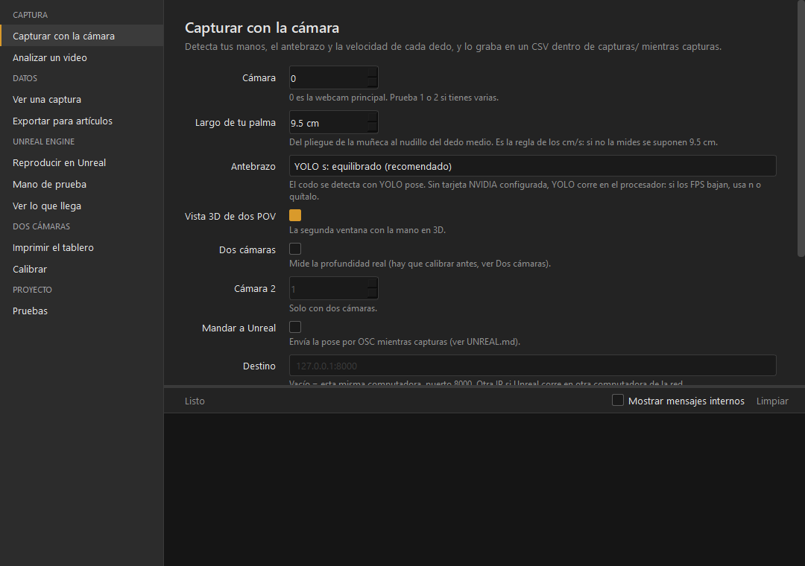
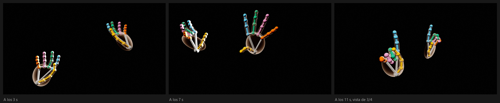

# HandMotion3D

Mide el movimiento de la **mano y el antebrazo en 3D** con una webcam: el esqueleto de cada mano (21 puntos, con MediaPipe), el codo (YOLO pose), la **velocidad de cada punto y de cada dedo en cm/s**, una vista 3D que se puede girar, y archivos CSV listos para analizar o para **publicaciones científicas**. Con dos webcams mide la profundidad real, puede analizar **videos ya grabados** y puede mover un **modelo 3D en Unreal Engine**.

> **Versión 23-B (2026-11-23).** Lo último: un **panel** para usar todo sin recordar comandos ([`panel.py`](#el-panel)), la conexión con **Unreal Engine probada en Unreal 5.8** con un proyecto listo para abrir ([`unreal/HandMotionUE`](UNREAL.md)), reproducir una captura guardada en Unreal como si fuera en vivo (`unreal_bridge.py --csv`) y el proyecto **probado en Windows**, con YOLO en la **GPU NVIDIA** (23-B). Historial completo en [`CHANGELOG.md`](CHANGELOG.md).

**Índice:** [Qué hace](#qué-hace) · [Requisitos](#requisitos) · [Instalación](#instalación) · [El panel](#el-panel) · [Primera captura](#primera-captura) · [Recetas](#recetas) · [Teclas](#teclas) · [Archivos que se generan](#archivos-que-se-generan) · [Problemas comunes](#problemas-comunes) · [Más documentación](#más-documentación) · [Apoyo de IA](#apoyo-de-inteligencia-artificial)

## Qué hace

| | |
|---|---|
| **Captura en vivo** (`captura.py`) | Esqueleto de cada mano con un color por dedo, antebrazo, flechas y números de velocidad, panel de estado y una vista 3D con dos puntos de vista independientes |
| **Guarda todo en CSV** | Mientras graba (si el programa se cae, no se pierde la sesión): posición y velocidad de cada punto en cada fotograma |
| **Resultados para artículos** (tecla `e` o `exportar_csv.py`) | Dos CSV: uno con formato de **ingeniería** (SI: media, RMS, σ, pico) y otro de **medicina** (media (DE), mediana [Q1-Q3]) |
| **Datos de la sesión** | Un `.json` junto a cada CSV con el participante, la fuente, los parámetros y las versiones, para la sección de métodos y la reproducibilidad |
| **Videos grabados** (`--video`) | Analiza un video en lugar de la cámara, con el tiempo del propio video |
| **Revisar una captura** (`plot_csv.py`) | Reproduce un CSV en 2D o en 3D, sin cámara |
| **Dos cámaras** (`estereo.py`, `--estereo`) | Profundidad y largo de la palma medidos en vez de estimados |
| **Unreal Engine** (`--unreal`, `unreal_bridge.py --csv`) | Manda la pose de la mano a Unreal en tiempo real, o reproduce una captura guardada como si fuera en vivo |
| **Panel** (`panel.py`) | Una ventana para lanzar todo lo anterior: cada opción explicada, el comando exacto que se ejecuta y su salida |

## Requisitos

- **Python 3.12 o más nuevo** (lo exige numpy 2.5, la versión fijada), salvo la 3.14.1, que torchvision excluye. Probado con **Python 3.14 en macOS (Apple Silicon)** y con **Python 3.13 en Windows 11** (desde la 23-A; en Windows, con las pruebas sin cámara y Unreal, todavía no con una webcam). En Linux debería funcionar, pero no se ha probado.
- Una **webcam** (o dos, para la profundidad real).
- **~1.5 GB libres**: el entorno instalado ocupa 1.2 GB (medido en macOS), casi todo por las librerías de YOLO (PyTorch). Con torch para NVIDIA (paso 2b) ocupa más; eso no se ha medido.
- Para la parte de Unreal: **Unreal Engine 5** (probado con 5.8) instalado desde el Epic Games Launcher.
- Con una **tarjeta NVIDIA** conviene instalar torch con CUDA (paso 2b de la instalación): el codo (YOLO) se calcula ~5 veces más rápido.
- **Internet la primera vez**, para instalar las librerías y descargar los modelos.

## Instalación

Se hace una sola vez. Todos los comandos se corren desde la carpeta del proyecto.

**1. Descargar el proyecto**

```bash
git clone https://github.com/N0x370z/Machine_Learning.git HandMotion3D
cd HandMotion3D
```

**2. Crear el entorno e instalar las librerías** (tarda unos minutos)

<table><tr><th>macOS / Linux</th><th>Windows (PowerShell)</th></tr><tr><td>

```bash
python3 -m venv venv
./venv/bin/python3 -m pip install -r requirements.txt
```

</td><td>

```powershell
python -m venv venv
venv\Scripts\python -m pip install -r requirements.txt
```

</td></tr></table>

**2b. Solo con tarjeta NVIDIA (Windows o Linux):** cambia torch por su versión con CUDA (~3 GB), para que YOLO use la GPU:

```powershell
venv\Scripts\python -m pip install --force-reinstall --no-deps torch==2.14.0+cu130 torchvision==0.29.0+cu130 --index-url https://download.pytorch.org/whl/cu130
venv\Scripts\python -c "import torch; print(torch.cuda.is_available())"   # tiene que decir True
```

Hace falta un driver NVIDIA reciente (CUDA 13; probado con el 621.24). Sin este paso todo funciona igual, pero YOLO corre en el procesador. En macOS no hace falta: usa la GPU de Apple sola.

**3. Descargar el modelo de la mano** (~8 MB). El de YOLO para el codo se descarga solo la primera vez que capturas.

<table><tr><th>macOS / Linux</th><th>Windows (PowerShell)</th></tr><tr><td>

```bash
mkdir -p models
curl -L -o models/hand_landmarker.task \
  https://storage.googleapis.com/mediapipe-models/hand_landmarker/hand_landmarker/float16/1/hand_landmarker.task
```

</td><td>

```powershell
mkdir models
curl.exe -L -o models\hand_landmarker.task `
  https://storage.googleapis.com/mediapipe-models/hand_landmarker/hand_landmarker/float16/1/hand_landmarker.task
```

</td></tr></table>

**4. Comprobar que todo quedó bien** (sin cámara, ~1 min):

```bash
./venv/bin/python3 pruebas/correr_todo.py
```

Al final aparece un `RESUMEN` con cinco pruebas, y las cinco tienen que decir `OK`. Si alguna dice `FALLA`, revisa [Problemas comunes](#problemas-comunes).

> **En Windows**, en todos los comandos de este README cambia `./venv/bin/python3` por `venv\Scripts\python` y las `/` de las rutas por `\`.
>
> **En macOS**, la primera vez que se abre la cámara el sistema pide permiso para la terminal (Terminal, iTerm, VS Code…). Si lo negaste: *Ajustes del Sistema → Privacidad y Seguridad → Cámara*, y vuelve a abrir la terminal.

## El panel

Para no tener que recordar comandos ni flags:

```bash
./venv/bin/python3 panel.py        # Windows: venv\Scripts\python panel.py
```



A la izquierda, cada cosa que se puede hacer (capturar, analizar un video, ver o exportar una captura, Unreal, dos cámaras, pruebas). Cada opción tiene debajo una línea que explica para qué sirve. Abajo se ve el **comando exacto** que se va a ejecutar (con *Copiar*, para usarlo en la terminal) y, al darle a **Ejecutar**, lo que va diciendo el programa. Las capturas se eligen de una lista con la fecha, la duración y el participante de cada una.

El panel no cambia nada: solo arma el comando y lo corre. Todo lo de este README sigue funcionando igual desde la terminal. Detalle en [docs/TECNICO.md](docs/TECNICO.md#el-panel-panelpy).

## Primera captura

**1. Mide tu palma** con una regla, del pliegue de la muñeca al nudillo del dedo medio (donde el dedo se une a la palma). Es la regla con la que se pasan las velocidades a cm/s. Si no la indicas se suponen 9.5 cm, y con una palma de 8.5 cm todas las velocidades salen ~12 % más altas.

**2. Empieza a capturar:**

```bash
./venv/bin/python3 captura.py --palma-cm 8.5
```

**3. Pon una o dos manos frente a la cámara.** Se abren dos ventanas:

- **La cámara**, en espejo: el esqueleto de cada mano con un color por dedo, la etiqueta `Left #0` / `Right #1` (mano izquierda o derecha real, y un número que la identifica), el antebrazo (sólido si se ve el codo, punteado si se estima) y la velocidad de cada dedo. Arriba a la izquierda, el panel de estado: FPS, manos y **`Frames grabados`**, que tiene que ir subiendo.
- **La vista 3D**, con la mano vista desde dos ángulos. Se gira arrastrando con el mouse y cada vista se mueve por separado (controles en [Teclas](#teclas)).

**4. Termina con `q`** (o `Esc`, o cerrando la ventana de la cámara). La terminal dice dónde quedó todo:

```
Datos exportados a capturas/hand_data_20261117_100000.csv
Datos de la sesión en capturas/hand_data_20261117_100000.json
```

**5. Revísala** sin cámara:

```bash
./venv/bin/python3 plot_csv.py        # animación 2D de la última captura
./venv/bin/python3 plot_csv.py --3d   # en 3D (espacio = pausa, a/d = fotograma anterior/siguiente)
```

## Recetas

### Una sesión para un artículo científico

```bash
./venv/bin/python3 captura.py --participante P01 --palma-cm 8.5 --notas "golpeteo 10 s, mano derecha"
# durante la captura: 'e' genera los dos CSV de resultados; 'q' termina
./venv/bin/python3 exportar_csv.py    # o después, de la última captura
```

Antes de empezar: código de participante (**nunca el nombre**), consentimiento, palma medida, cámara fija y la misma distancia y luz en todas las sesiones. Quedan el CSV crudo, el `.json` de la sesión y, en `capturas/articulos/`, los CSV de **ingeniería** y de **medicina**. Lista completa de pasos, qué significa cada columna, las ecuaciones y lo que hay que saber antes de publicar: **[docs/ARTICULOS.md](docs/ARTICULOS.md)**.

> La rapidez **todavía no está validada contra un sistema de referencia**. Antes de reportarla como medida clínica o de ingeniería, hay que validarla.

### Analizar un video grabado

```bash
./venv/bin/python3 captura.py --video sesiones/P01.mp4 --participante P01 --palma-cm 8.5
```

El tiempo de cada fotograma sale del video, así que las velocidades son las reales aunque el análisis vaya más lento que el video. Termina solo al acabar el video. Si el video ya está en espejo (grabado con la cámara frontal de un celular viéndose como en un espejo), agrega `--video-espejado`; si Left/Right salen al revés, agrega o quita esa opción. Más en [docs/ARTICULOS.md](docs/ARTICULOS.md#reproducibilidad-reanalizar-un-video).

### Medir la profundidad real con dos cámaras

Dos webcams fijas, separadas 10–30 cm y mirando a la misma zona:

```bash
./venv/bin/python3 estereo.py tablero                  # 1. genera calibracion/tablero_9x6.png: imprímelo
./venv/bin/python3 estereo.py calibrar --cuadro-mm 25  # 2. calibra; 25 = lado de un cuadro impreso, medido con regla
./venv/bin/python3 captura.py --estereo                # 3. captura con las dos
```

Con dos cámaras la palma se mide sola (no hace falta `--palma-cm`). Si mueves una cámara, hay que volver a calibrar. Detalle en [docs/TECNICO.md](docs/TECNICO.md#dos-cámaras-estereopy).

### Mover una mano 3D en Unreal Engine

1. Abre **`unreal/HandMotionUE/HandMotionUE.uproject`** (o el botón *Abrir proyecto de Unreal* del panel). La mano aparece en cuanto llegan datos.
2. Mándale datos, de una de estas formas:

```bash
./venv/bin/python3 captura.py --unreal                    # en vivo, con la cámara
./venv/bin/python3 unreal_bridge.py --csv --bucle         # una captura guardada (la última), como si fuera en vivo
./venv/bin/python3 unreal_bridge.py --csv capturas/hand_data_20260924_135051.csv --bucle   # una de las capturas reales del repositorio
./venv/bin/python3 unreal_bridge.py --demo 127.0.0.1:8000 # una mano sintética
```



*Renders reales de Unreal Engine 5.8 (2026-11-23): la mano que recibió Unreal de `unreal_bridge.py --csv` (la más abierta y la más cerrada de la captura). La captura es el ejemplo simulado que genera las pruebas, no una mano real.* Se regeneran con `docs/imagenes_unreal.py`. El proyecto, el formato de los mensajes y cómo hacerlo con un Blueprint y otro modelo: **[UNREAL.md](UNREAL.md)**.

### Más opciones de `captura.py`

| Para… | Agrega |
|-------|--------|
| Que reconozca mejor la mano (poca luz, lejos) | `--min-detection-confidence 0.3 --min-tracking-confidence 0.3` |
| Que vaya más rápido | `--sin-antebrazo` (no carga YOLO) o `--yolo-modelo n` |
| Detectar mejor el codo | `--yolo-modelo m` |
| No abrir la vista 3D | `--sin-3d` |
| Usar otra cámara | `--cam 1` |

Todos los flags, de todos los programas: [`COMANDOS.md`](COMANDOS.md).

## Teclas

Funcionan con cualquiera de las ventanas activa (haz clic en una si no responde).

| Tecla | En la captura |
|-------|---------------|
| `espacio` o `p` | **Pausa** / sigue (en pausa no se graba nada) |
| `e` | Los **dos CSV para artículos** de lo grabado hasta ahora |
| `s` | Foto de la cámara en `capturas/` |
| `n` / `v` | Mostrar u ocultar los nombres de los dedos / la velocidad |
| `f` | Velocidad de los dedos absoluta o relativa a la muñeca |
| `u` | Con `--unreal`: pausa o reanuda el envío |
| `q` o `Esc` | **Terminar** (todo queda guardado) |

| En la vista 3D (sobre la vista que tenga el mouse encima) | |
|---|---|
| Arrastrar | Girar |
| `Shift` + arrastrar o botón central | Mover |
| Rueda, clic derecho, `+` / `-` | Zoom |
| `1` `3` `7` `9` | Vista de frente, de lado, desde arriba, opuesta |
| `.` / `r` | Encuadrar las manos / reiniciar la vista |
| `l` | Mover las dos vistas juntas (a 180°) |

## Archivos que se generan

Todo queda en `capturas/`, que **no se sube a git** por defecto: puede tener datos de participantes. Las únicas excepciones son las **14 capturas de prueba del equipo** (septiembre y octubre de 2026), que se subieron a propósito para trabajarlas en otra computadora (Unreal, GPU). Qué tiene cada una y cómo usarlas: [`capturas/README.md`](capturas/README.md).

| Archivo | Qué es |
|---------|--------|
| `hand_data_<fecha>_<hora>.csv` | La captura: una fila por punto y fotograma ([columnas](docs/TECNICO.md#formato-del-csv-exportado)) |
| `hand_data_<fecha>_<hora>.json` | Cómo se midió: participante, fuente, parámetros, versiones ([campos](docs/ARTICULOS.md#datos-de-la-sesión-json)) |
| `articulos/…_ingenieria.csv`, `articulos/…_medicina.csv` | Resultados para artículos ([columnas](docs/ARTICULOS.md#exportar-para-artículos-exportar_csvpy)) |
| `screenshot_*.png` | Fotos tomadas con `s` |

El nombre lleva la fecha y hora de **inicio** de la sesión. Si no se detectó ninguna mano, no se crea nada.

## Problemas comunes

| Síntoma | Solución |
|---------|----------|
| `No se pudo abrir la cámara` | Da permiso de cámara a la terminal (ver [Instalación](#instalación)), ciérrala y ábrela de nuevo. Cierra otras apps que usen la cámara (Zoom, FaceTime…). Si hay varias cámaras, prueba `--cam 1` |
| `No se encontró el modelo en models/hand_landmarker.task` | Falta el paso 3 de la [instalación](#instalación) |
| Le cuesta detectar la mano o la pierde | Más luz, acerca la mano, o `--min-detection-confidence 0.3 --min-tracking-confidence 0.3` |
| `Frames grabados` se queda en 0 | No ve ninguna mano: revisa la luz y que la mano entera entre en cuadro |
| Las velocidades en cm/s parecen altas o bajas | Indica tu palma: `--palma-cm 8.5`, o usa dos cámaras |
| Va lento (pocos FPS) | La línea `ms:` del panel dice qué etapa tarda. Si es `yolo` y tienes NVIDIA: instala torch con CUDA ([paso 2b](#instalación)); si no, `--yolo-modelo n` o `--sin-antebrazo`; si es `mano`: `--max-hands 2` o `--cam-width 960 --cam-height 540` |
| El antebrazo sale punteado (`Codo (estimado)`) | YOLO no ve el codo: aléjate para que entre en cuadro. `--yolo-modelo m` detecta mejor; `--antebrazo-solo-yolo` no dibuja estimados |
| Las teclas no hacen nada | Haz clic en una de las ventanas para darle el foco |
| Con `--video`, Left/Right al revés | Agrega o quita `--video-espejado` |
| `OpenCV no pudo abrir` el video | Formato o códec no soportado: conviértelo a mp4 (H.264) |
| `No hay calibración en calibracion/estereo.npz` | Antes de `--estereo` hay que calibrar (ver [dos cámaras](#medir-la-profundidad-real-con-dos-cámaras)) |
| Con `--estereo` el panel dice `Estereo: 0/1 manos` | La cámara 2 no ve la mano (mira su ventana) o una cámara se movió: vuelve a calibrar |
| `La cámara dejó de entregar imágenes` | Se desconectó o la tomó otra app. Lo grabado hasta ese momento queda guardado |
| Crashea con `Service is unavailable` | Se actualizó `mediapipe`: reinstala las versiones fijadas con `./venv/bin/python3 -m pip install -r requirements.txt` |
| `import cv2` falla después de instalar algo | Las dos variantes de OpenCV quedaron en versiones distintas: `./venv/bin/python3 -m pip install --force-reinstall opencv-python==5.0.0.93 opencv-contrib-python==5.0.0.93` |
| Error al descargar `yolo11s-pose.pt` | Hace falta internet la primera vez. Mientras tanto: `--sin-antebrazo` |
| `can't open file 'Prueba.py'` | Ahora se llama `captura.py` |
| En Unreal no se mueve nada | Mira `unreal/HandMotionUE/Saved/handmotion_receptor.log`: si no dice `llegó la mano`, no llegan datos (¿corre `captura.py --unreal` o `unreal_bridge.py --csv`? ¿mismo puerto?). Con *Ver lo que llega* del panel se comprueba el envío sin Unreal (con Unreal cerrado: los dos usan el puerto 8000) |
| En Windows, la consola muestra `c�mara` en vez de `cámara` | Solo es la consola: el CSV está bien. Para verlo bien, `set PYTHONIOENCODING=utf-8` antes de correr, o usa el panel |

## Más documentación

| Documento | Para qué |
|-----------|----------|
| [docs/ARTICULOS.md](docs/ARTICULOS.md) | **Para publicar**: sesión paso a paso, los dos CSV de resultados, ecuaciones, datos de la sesión, reproducibilidad, qué tener en cuenta |
| [docs/TECNICO.md](docs/TECNICO.md) | **Cómo funciona** cada parte: detección, seguimiento, vista 3D, antebrazo, velocidad (filtro One Euro), dos cámaras, formato del CSV, versiones fijadas, pruebas |
| [UNREAL.md](UNREAL.md) | Conexión con Unreal Engine: formato de los mensajes, plugin OSC, Blueprint |
| [COMANDOS.md](COMANDOS.md) | Todos los comandos, flags y teclas; bitácora de mantenimiento |
| [docs/CAMBIOS.md](docs/CAMBIOS.md) | Comandos, teclas y partes que cambiaron o se quitaron, y por qué |
| [CHANGELOG.md](CHANGELOG.md) | Historial fechado, versión por versión |
| [REVISION.md](REVISION.md) | Revisiones del proyecto y pendientes |
| [pruebas/README.md](pruebas/README.md) | Pruebas sin cámara: qué comprueba cada una |

## Apoyo de inteligencia artificial

El desarrollo de HandMotion3D contó con el apoyo de un asistente de IA (Claude Code, de Anthropic) para escribir y revisar código, pruebas y documentación. Las decisiones, la revisión y la responsabilidad sobre el programa y sus resultados son del equipo del proyecto. Lo hecho se verificó con las pruebas de `pruebas/`, que son simulaciones; **las pruebas con cámaras reales y la validación de la medición contra una referencia están pendientes** ([`REVISION.md`](REVISION.md)). Si publicas con estos datos, revisa la política de tu revista sobre declarar el uso de IA.

<a id="historial"></a>El proyecto se llamaba **MediaPipeHands** y vivía en una carpeta del repositorio `Machine_Learning`; desde la versión 24-E (2026-09-24) se llama **HandMotion3D** y ocupa la raíz del repositorio. El repositorio de GitHub todavía no se ha renombrado.
