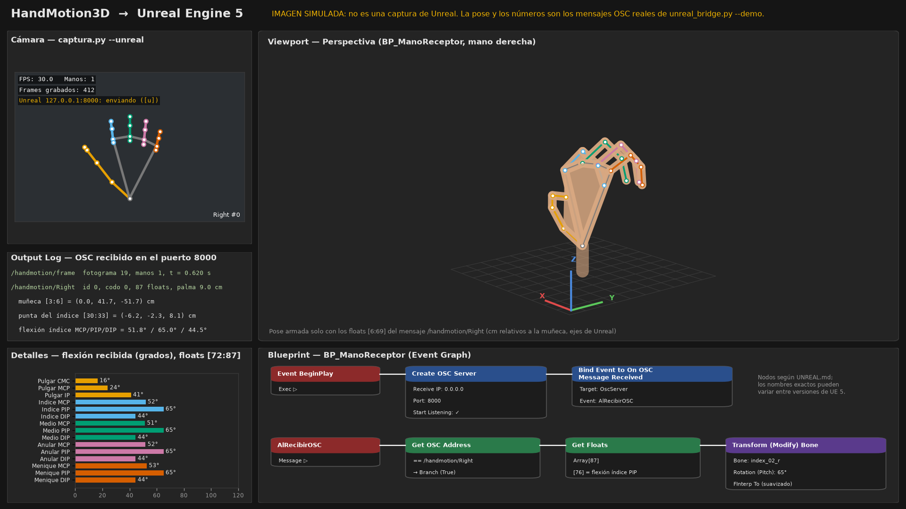
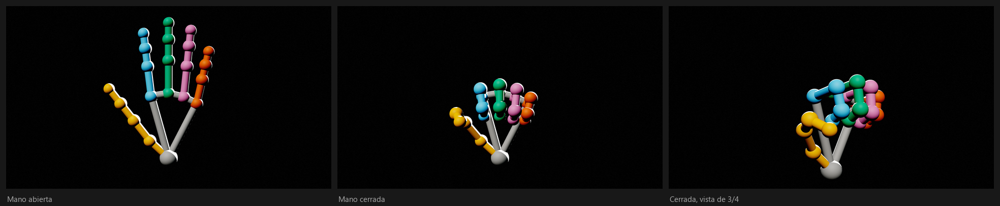
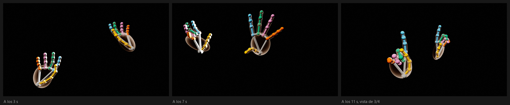
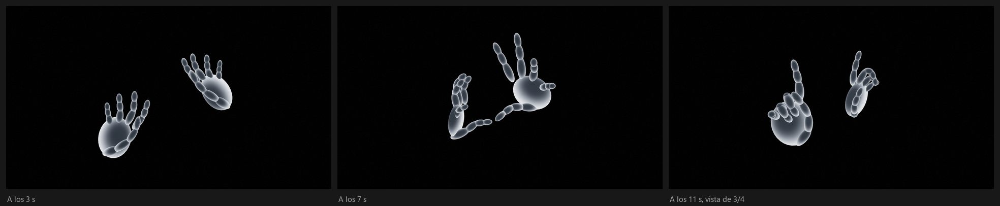

# Conexión con Unreal Engine — HandMotion3D

Cómo hacer que una mano 3D en **Unreal Engine 5** siga el movimiento de tus manos, con lo que detecta `captura.py` o con una captura guardada. Funciona desde la versión **19-A** (2026-10-19); desde la **23-A** (2026-11-23) está **probado en Unreal Engine 5.8** y el repositorio trae un proyecto listo para abrir.

## Así se ve


Renders **reales** de Unreal Engine 5.8.4 (no una simulación), hechos con el **mismo receptor que se ve en vivo**: `unreal_bridge.py --csv` mandó la captura real `capturas/hand_data_20260924_135051.csv` por OSC/UDP, el proyecto [`unreal/HandMotionUE`](unreal/HandMotionUE) la recibió (170 fotogramas, ver [`docs/unreal_imagenes.json`](docs/unreal_imagenes.json)) y se renderizó la vista del editor a los 3, 7 y 11 segundos. **Manos de VR** (2026-11-24): las dos manos como siluetas blanco azuladas, con el centro oscuro y el borde brillante, como las manos "fantasma" de los visores de realidad virtual; el movimiento va suavizado. Hay otro estilo, con el esqueleto de colores y una piel translúcida (`HM_ESTILO=esqueleto`, ver abajo). Cómo se veía en cada etapa: [historial del aspecto](#cómo-se-veía-antes-historial-del-aspecto).

Para volver a generarlas (Unreal se abre **sin ventana**, así no interrumpe lo que haya en pantalla, y se cierra solo):

```bash
./venv/bin/python3 docs/imagenes_unreal.py [capturas/una_captura.csv]
```

## Estado de la prueba

| Qué | Estado |
|-----|--------|
| Python: formato de los mensajes, ejes, ángulos, envío por UDP, `--csv` | Probado sin Unreal ([`pruebas/unreal_simulado.py`](pruebas/README.md)) |
| Unreal recibe los mensajes y mueve la mano (proyecto `unreal/HandMotionUE`) | **Probado en UE 5.8.4** (2026-11-23): 495 de 495 fotogramas recibidos, la flexión del índice va de 9° a 74° y vuelve, igual que en el CSV |
| El plugin OSC de Unreal recibe los paquetes y dispara *On OSC Message Received* | **Probado en UE 5.8.4** |
| Leer el mensaje OSC desde **Python** dentro de Unreal | **No se puede** en UE 5.8 (ver abajo). Por eso el receptor del proyecto decodifica el OSC él mismo |
| El **Blueprint** de los pasos 2 a 4 | Sin probar todavía: los nombres de los nodos se revisaron contra el código del plugin de UE 5.8 |
| Con una webcam real en Windows | Sin probar (no había webcam) |

**Por qué el receptor no usa el plugin OSC.** Se probó primero (es lo que haría un Blueprint): el servidor OSC recibe y dispara el evento, pero `FOSCMessage` guarda el contenido en un campo que no es `UPROPERTY`, y cuando Unreal se lo pasa a Python llega una **copia vacía** (dirección `/`, sin floats). En Blueprint el mensaje se pasa por referencia nativa y sí trae el contenido. El receptor de Python abre su propio socket UDP en el mismo puerto y decodifica el OSC (unas 10 líneas, `handmotion_escena.osc_decode`).

## Paso 0 — El proyecto listo (lo más rápido)

1. Abre `unreal/HandMotionUE/HandMotionUE.uproject` con Unreal Engine 5 (o el botón **Abrir proyecto de Unreal** del [panel](README.md#el-panel)). Si pregunta por la versión del motor, elige la tuya; usa solo los plugins **Python Editor Script Plugin** y **OSC**, que vienen con Unreal.
2. Al abrirse, `Content/Python/init_unreal.py` arranca el receptor (`receptor_handmotion.py`): crea un nivel en blanco con luces y la cámara del *viewport* frente a la mano, y escucha en el **puerto 8000**.
3. Manda datos:

```bash
./venv/bin/python3 unreal_bridge.py --csv --bucle     # la última captura, en bucle
./venv/bin/python3 captura.py --unreal                # o en vivo con la cámara
```

La mano aparece con el primer mensaje. Lo que va llegando se registra en `unreal/HandMotionUE/Saved/handmotion_receptor.log` (una línea por segundo: fotogramas, palma, muñeca, flexión del índice).

| Archivo (en `unreal/HandMotionUE/Content/Python/`) | Qué hace |
|---|---|
| `init_unreal.py` | Unreal lo corre al abrir el proyecto: arranca el receptor (o, con `HM_CAPTURA=1`, el render de las imágenes) |
| `handmotion_escena.py` | La mano: la envoltura (un elipsoide por falange y la palma como una esfera aplastada) y, en el estilo "esqueleto", el esqueleto de colores (21 esferas y 21 cilindros, material mate); las luces, la exposición fija, el suavizado y cómo poner una pose a partir de los 87 floats. Crea la primera vez los materiales (`M_ManoVR_v2`, `M_PielTranslucida_v3`, `M_HuesoMate_v1`) en `Content/HandMotion/` (no van en git) |
| `receptor_handmotion.py` | Escucha el puerto, decodifica el OSC y mueve **hasta dos manos** en cada tick del editor; filtra detecciones falsas, suaviza la posición y pone la cámara del viewport frente a las manos con la vista de juego (sin iconos de luces) |
| `capturar_imagenes.py` | Las imágenes de esta guía: usa el mismo receptor y renderiza su vista (lo usa `docs/imagenes_unreal.py`) |

`Config/DefaultEditorPerProjectUserSettings.ini` quita el freno de Unreal cuando su ventana no está al frente (si no, la mano se traba mientras usas otra ventana).

**Dos manos.** Cada mano que llega (por su id) ocupa uno de dos lugares; si deja de llegar medio segundo se oculta. Se dibujan con su separación real y centradas: el centro sigue, suavizado, al promedio de las muñecas. Casi todas las capturas guardadas tienen las dos manos (ver [`capturas/README.md`](capturas/README.md)).

**Estilos.** Por defecto, **manos de VR**: material opaco y sin iluminación, casi negro de frente y blanco azulado brillante en los bordes (Fresnel). Al ser opaco, las piezas se funden en una sola silueta, y sobre el fondo negro el centro oscuro se lee como transparente. Con `HM_ESTILO=esqueleto` (o *Estilo en Unreal → Esqueleto con piel* en el panel, antes de *Abrir proyecto de Unreal*) se ve el esqueleto de colores por dedo con una piel translúcida color piel encima. Las dos son envolturas aproximadas, no un modelo de mano con piel: para mover un personaje (Mannequin, MetaHuman…) se usan los mismos datos con los pasos de abajo.

**Movimiento suave.** Cada parte de la mano se acerca a su posición nueva en cada tick de Unreal (constante de tiempo 80 ms): interpola entre los fotogramas de la captura (15-30 por segundo; Unreal va a 60 o más) y filtra el temblor de MediaPipe. La **posición** de cada mano se suaviza más: con una cámara, la muñeca en cm se calcula con el largo de la palma en la imagen, y cuando la palma gira esa escala cambia y la muñeca salta 8-16 cm entre fotogramas. Por eso se muestra el 35 % del desplazamiento del par de manos y el 80 % de la separación entre ellas (mínimo 14 cm, para que no se encimen). Una mano nueva aparece después de 3 mensajes seguidos: así no parpadean las detecciones falsas de MediaPipe (en las capturas hay manos de 1-2 fotogramas).

**Cómo se ve, y por qué** (2026-11-24): fondo negro; exposición fija (EV100 = 2) también en el viewport, con un volumen de post-proceso (con la automática se quemaba u oscurecía); la cámara del viewport se coloca cuando el editor terminó de cargar (antes quedaba mirando a otro lado y no se veía nada). Todas las decisiones, con imágenes: [historial del aspecto](#cómo-se-veía-antes-historial-del-aspecto).

## Cómo se veía antes (historial del aspecto)

Cada etapa, con lo que se cambió y por qué. Las imágenes están en [`docs/unreal_historial/`](docs/unreal_historial); salvo la primera, son renders reales de Unreal Engine 5.8.

| # | Fecha | Cómo se veía | Por qué se cambió |
|---|-------|--------------|-------------------|
| 1 | 2026-11-17 (17-A) |  **Simulación** hecha con matplotlib (no es Unreal): la ventana de la captura, los mensajes y la mano en los ejes de Unreal | No se tenía Unreal; era un esquema del recorrido de los datos |
| 2 | 2026-11-23 (23-A) |  Primer render real: **esqueleto de colores** (esferas y cilindros, un color por dedo) sobre negro, **una sola mano**, con el ejemplo simulado | Funcionaba, pero solo una mano (las capturas reales tienen dos) y sin volumen |
| 3 | 2026-11-24 |  **Dos manos** con una **piel translúcida color piel** encima del esqueleto, con una captura real | Se pidió que se vieran como manos de VR |
| 4 | 2026-11-24 (actual) |  **Manos de VR**: silueta blanco azulada, centro oscuro y borde brillante, sin esqueleto; movimiento suavizado | — |

Intentos que no llegaron a quedar (no se guardaron imágenes; se describen para no repetirlos):

| Intento | Qué se veía | Qué se hizo |
|---------|-------------|-------------|
| Render en un *commandlet* | Imagen **negra** (el motor no avanza entre poner la pose y capturar) | Editor con `-RenderOffscreen` |
| Exposición manual por defecto (EV100 ≈ 10) | Imagen **negra** (la escena tiene ~10 lux) | Exposición fija EV100 = 2 |
| Nivel por defecto del editor | Cielo, montañas y cuadrícula detrás; piso **quemado en blanco** por el sol | Nivel en blanco con luces propias |
| Piso oscuro / fondo oscuro | Salían **blancos** (reflejo del mapa de ambiente) | Sin piso ni fondo: la mano sobre negro |
| Luz de contorno a 1800 | Medias lunas **blancas** en el borde de las esferas | Luz de contorno a 120 y material mate para el esqueleto |
| Piel translúcida **con iluminación** | Manchas blancas (reflejos) | Piel sin iluminación (Fresnel) |
| Mano de VR **translúcida** con cilindros y esferas | **Anillos** en cada articulación (tapas de los cilindros y esferas encimadas) | Falanges como elipsoides |
| Mano de VR translúcida con elipsoides | Dedos como **cuentas de collar** (se veía el borde de cada pieza) | Material opaco: las piezas se funden en una sola silueta |
| Cámara del viewport colocada al arrancar | **No se veía nada**: la cámara quedaba mirando a otro lado (el viewport aún no existía) | Se coloca cuando el editor terminó de cargar, y se comprueba |
| Dos manos siguiendo el 100 % del movimiento | **Vibraban** y se salían de cuadro (la escala cambia con el giro de la palma: saltos de 8-16 cm) | Suavizado, 35 % del desplazamiento del par, 80 % de la separación, mínimo 14 cm entre manos |
| Dos manos siguiendo el 35 % de todo | **Encimadas** | Separación al 80 % con un mínimo de 14 cm |

### Reproducir una captura guardada (`--csv`, 23-A)

`unreal_bridge.py --csv [ruta]` manda un CSV de `captura.py` **con los mismos tiempos con los que se grabó**, como si fuera en vivo. Sin ruta usa el más reciente de `capturas/`.

| Flag | Para qué |
|------|----------|
| `--destino HOST:PUERTO` | A dónde mandar (por defecto `127.0.0.1:8000`) |
| `--velocidad 2` | El doble de rápido (`0.5` = la mitad) |
| `--bucle` | Volver a empezar al terminar |
| `--segundos N` | Terminar solo tras N segundos |
| `--swap-hands` | Invertir Left/Right: capturas de antes del 2026-09-23, que la guardaban al revés (ver [`capturas/README.md`](capturas/README.md)) |

Si el CSV se grabó con `--estereo`, la muñeca va con su posición absoluta (columnas `x_cm`, `y_cm`, `z_cm`). Los fotogramas sin manos no están en el CSV, así que no se mandan.

## Cómo viaja la información

```
cámara ──► captura.py ──► unreal_bridge.py ──► OSC / UDP ──► plugin OSC de Unreal ──► Blueprint ──► huesos del modelo
           (MediaPipe)    (cm, ejes de UE,     puerto 8000    (OSC Server)
                           flexión en grados)
```

- **OSC** (Open Sound Control) sobre **UDP**: ligero, sin conexión (si Unreal no está escuchando, simplemente se pierden los paquetes y `captura.py` sigue igual).
- Unreal Engine 5 trae el **plugin OSC**; no hay que instalar nada más. En Python el codificador OSC es propio: **no hay dependencias nuevas** por esto.

## Paso 1 — Probar el envío sin Unreal (para tu propio proyecto)

Con dos terminales (desde la raíz del repositorio):

```bash
./venv/bin/python3 unreal_bridge.py --escuchar 8000                # terminal 1: muestra lo que llega
./venv/bin/python3 unreal_bridge.py --demo 127.0.0.1:8000          # terminal 2: una mano sintética abriendo y cerrando los dedos
```

En la terminal 1 deben verse líneas como:

```
/handmotion/frame  fotograma 0, manos 1, t = 0.000 s
/handmotion/Right  id 0, codo 0, 87 floats; flexión índice (MCP/PIP/DIP):   8.6 /   0.0 /   0.0
```

Con la cámara de verdad: `./venv/bin/python3 captura.py --unreal` (o `--unreal 192.168.1.20:8000` si Unreal corre en **otra computadora** de la misma red; abre el puerto UDP en su firewall). En el panel de la cámara aparece `Unreal 127.0.0.1:8000: enviando ([u])`; la tecla `u` pausa y reanuda el envío sin parar la captura, y la **pausa** (`espacio`) también detiene el envío.

## Paso 2 — Activar el plugin en Unreal

1. **Edit → Plugins**, busca **OSC** (categoría *Protocols*) y actívalo.
2. Reinicia el editor.

## Paso 3 — Recibir los mensajes (Blueprint)

1. Crea un **Blueprint Actor** (por ejemplo `BP_ManoReceptor`) y colócalo en el nivel.
2. En el **Event BeginPlay**: nodo **Create OSC Server** con *Receive IP Address* `0.0.0.0` (o `127.0.0.1` si todo está en la misma máquina), *Port* `8000` y *Start Listening* activado. Guarda el resultado en una variable `OscServer`.
   **Guarda el servidor en una variable del actor**: si no queda referenciado, el recolector de basura de Unreal lo destruye a los pocos fotogramas y deja de recibir (en el log: `Destroying OSC Socket Receiver`). Pasó en la prueba de la 23-A.
3. Con `OscServer`: **Bind Event to On OSC Message Received** y conecta un evento propio.
4. En ese evento recibes el mensaje: usa **Get OSC Message Address** y, para tener el texto, **Get OSC Address Full Path** (en UE 5.8 no hay un nodo "convert to string"); compáralo con `/handmotion/Right` o `/handmotion/Left` (y `/handmotion/frame` si quieres saber cuántas manos hay en el fotograma).
5. Para leer los números, usa los nodos de **OSC → Message** que obtienen los **floats** del mensaje (por índice, o todos a la vez en un arreglo). **Todos los mensajes llevan solo floats**, y en cada mano van en este orden (87 valores):

| Índices | Qué es | Unidad |
|---------|--------|--------|
| `[0]` | id de la mano (el seguimiento; cambia si la pierde de vista y la recupera) | — |
| `[1]` | tiene codo: `1` si hay codo (YOLO o estimado), `0` si no | — |
| `[2]` | largo de la palma (la escala de la mano) | cm |
| `[3..5]` | posición de la **muñeca** (X, Y, Z de Unreal) | cm |
| `[6..68]` | los **21 puntos** de la mano (X, Y, Z cada uno), **relativos a la muñeca**: el punto `n` está en `[6 + 3n .. 8 + 3n]`; el punto 0 (muñeca) es `(0, 0, 0)` | cm |
| `[69..71]` | **codo** relativo a la muñeca (`0, 0, 0` si no hay) | cm |
| `[72..86]` | **flexión** de 15 articulaciones (ver tabla de abajo) | grados |

Los puntos son los de MediaPipe (0 muñeca; 1-4 pulgar; 5-8 índice; 9-12 medio; 13-16 anular; 17-20 meñique; la punta de cada dedo es 4, 8, 12, 16 y 20).

### Ejes y unidades

Convención de Unreal: **X adelante, Y derecha, Z arriba, centímetros.**

| Eje de Unreal | Qué es en la imagen |
|---------------|---------------------|
| X (adelante) | profundidad: positivo = se **aleja** de la cámara |
| Y (derecha) | derecha de la pantalla (la imagen está en espejo, como te ves tú) |
| Z (arriba) | arriba de la pantalla |

Con **una cámara** la profundidad absoluta de la muñeca se desconoce (`[3]` queda en `0`) y la de los dedos es la `z` relativa de MediaPipe, aproximada. Con **dos cámaras** (`--estereo`) la posición de la muñeca (`[3..5]`) es absoluta, en cm respecto a la cámara 1.

### Flexión: 0° = dedo estirado, positivo = doblado

Es 180° menos el ángulo entre los dos huesos que se unen en la articulación. Es lo más cómodo para mover un esqueleto, porque cada articulación necesita **un solo giro**:

| Índice | Dedo | Articulación | Hueso del Mannequin de UE5 (mano derecha) |
|--------|------|--------------|-------------------------------------------|
| `[72]` | Pulgar | CMC | `thumb_01_r` |
| `[73]` | Pulgar | MCP | `thumb_02_r` |
| `[74]` | Pulgar | IP | `thumb_03_r` |
| `[75]` | Índice | MCP | `index_01_r` |
| `[76]` | Índice | PIP | `index_02_r` |
| `[77]` | Índice | DIP | `index_03_r` |
| `[78]`-`[80]` | Medio | MCP, PIP, DIP | `middle_01_r`, `middle_02_r`, `middle_03_r` |
| `[81]`-`[83]` | Anular | MCP, PIP, DIP | `ring_01_r`, `ring_02_r`, `ring_03_r` |
| `[84]`-`[86]` | Meñique | MCP, PIP, DIP | `pinky_01_r`, `pinky_02_r`, `pinky_03_r` |

Los nombres de hueso son los del Mannequin de UE5 (con `_l` en vez de `_r` para la mano izquierda); si usas otro modelo (MetaHuman u otro), cámbialos por los suyos. **El eje de giro del dedo depende del esqueleto** (en muchos es el eje local Y o Z): pruébalo con `--demo`, que dobla y estira los dedos en bucle, hasta que el dedo del modelo se doble hacia la palma.

## Paso 4 — Mover el modelo

Dos formas, de más simple a más completa:

1. **Solo dedos (lo más simple):** en un **Anim Blueprint** (o con *Transform (Modify) Bone* en el Anim Graph), aplica a cada hueso de la tabla un giro de `flexión` grados. Deja la muñeca del modelo donde la pone tu animación.
2. **Muñeca y antebrazo:** usa `[3..5]` como posición objetivo de la mano (por ejemplo, el objetivo de un **IK de brazo** o de un *Control Rig*) y `[69..71]` para el codo. La **orientación** de la mano (hacia dónde apunta la palma) **no se manda**: se calcula en Unreal con los puntos 0, 5 y 17 (el producto cruz de `punto5 − punto0` y `punto17 − punto0` es la normal de la palma). Si prefieres que Python la mande ya calculada, es una mejora pendiente (ver abajo).

Consejos:

- **Suaviza** en Unreal (por ejemplo `FInterp To` o `Interp To`): los mensajes llegan a los FPS de la cámara (~30), menos que los de Unreal.
- **Izquierda y derecha:** el nombre del mensaje (`/handmotion/Left`, `/handmotion/Right`) es la mano **real** de la persona, ya corregida. Si el modelo se ve "al revés", es que está espejado respecto a la cámara: cambia el signo del eje Y.
- **Dos manos:** el mismo Blueprint puede atender a las dos, cada una con su dirección.

## Qué pasa cuando…

| Situación | Qué ocurre |
|-----------|------------|
| Pausas la captura (`espacio` o `p`) | No se manda nada: el modelo se queda en la última pose |
| Pausas solo el envío (`u`) | La captura y el CSV siguen; Unreal no recibe |
| La mano sale de cámara | Se sigue mandando `/handmotion/frame` con `manos = 0` y ya no llegan mensajes de mano: el Blueprint debe decidir si congela o relaja el modelo |
| Unreal no está abierto | Los paquetes se pierden; `captura.py` no se entera ni se frena |
| Los dos corren en máquinas distintas | `--unreal IP:PUERTO`, misma red, puerto UDP abierto en el firewall del que recibe |

## Limitaciones y pendientes

- **El Blueprint no se probó todavía** (el proyecto de la 23-A usa Python, ver [Estado de la prueba](#estado-de-la-prueba)). Lo que hay que confirmar al armarlo: el eje de giro de los dedos del modelo.
- La imagen simulada de la 17-A ([`docs/unreal_simulado.png`](docs/unreal_simulado.png), `docs/imagen_unreal.py`) se conserva como esquema del recorrido de los datos, pero ya no es lo que se muestra: las imágenes reales están en [Así se ve](#así-se-ve).
- **Una cámara = profundidad aproximada.** Los dedos se doblan bien de frente; la profundidad fina mejora con `--estereo`.
- **No se manda la orientación de la muñeca** (se calcula en Unreal con los puntos 0, 5 y 17). Mejora pendiente: mandarla como cuaternión.
- **No se manda audio, imagen ni el CSV**: solo la pose. Para el CSV y los CSV para artículos, ver [docs/ARTICULOS.md](docs/ARTICULOS.md#exportar-para-artículos-exportar_csvpy).
- El `id` de la mano cambia si la pierde de vista; el nombre del mensaje (`Left`/`Right`) es más estable para elegir qué mano mover.

Historial de cambios: [`CHANGELOG.md`](CHANGELOG.md) (versiones 19-A y 23-A) · Comandos: [`COMANDOS.md`](COMANDOS.md).
