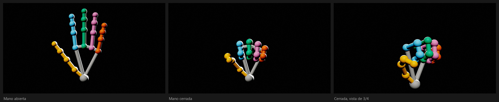
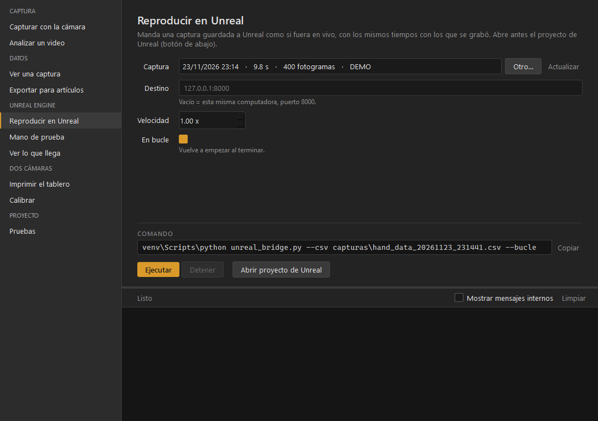

# Cómo funciona — HandMotion3D

Documentación técnica: cómo funciona cada parte, todos sus flags y por qué está hecha así. Para **usar** el programa basta el [README](../README.md); para publicar con estos datos, [ARTICULOS.md](ARTICULOS.md).

> Hasta la versión 17-E (2026-11-17) todo esto estaba dentro del README, que había llegado a 1,100 líneas. Se movió aquí sin recortar; el README quedó como guía de uso.

## Índice

- [Estructura del proyecto](#estructura-del-proyecto)
- [Instalación: detalles y versiones fijadas](#instalación-detalles-y-versiones-fijadas)
- [`captura.py` — captura en vivo](#capturapy--captura-en-vivo)
- [Vista 3D con dos POV (`viewer3d.py`)](#vista-3d-con-dos-pov-viewer3dpy)
- [Antebrazo (`forearm.py`)](#antebrazo-forearmpy)
- [Velocidad (`kinematics.py`)](#velocidad-kinematicspy)
- [Dos cámaras (`estereo.py`)](#dos-cámaras-estereopy)
- [`plot_csv.py` — graficar los puntos del CSV](#plot_csvpy--graficar-los-puntos-del-csv)
- [Pausa](#pausa)
- [Unreal Engine (`unreal_bridge.py`)](#unreal-engine-unreal_bridgepy)
- [El panel (`panel.py`)](#el-panel-panelpy)
- [Pruebas](#pruebas)

## Estructura del proyecto

```
HandMotion3D/           # raíz del repositorio
├── captura.py          # Captura en vivo: cámara(s) + MediaPipe + CSV (antes Prueba.py)
├── plot_csv.py         # Grafica los landmarks guardados en un CSV (2D o 3D)
├── hand_style.py       # Colores por dedo (y antebrazo) compartidos por todas las vistas
├── viewer3d.py         # Visor 3D con dos POV (estilo viewports de Blender)
├── forearm.py          # Antebrazo: codo con YOLO pose + estimación de su z
├── kinematics.py       # Velocidad (filtro One Euro) y escala en cm (palma)
├── estereo.py          # Dos cámaras: calibración y triangulación (profundidad real)
├── exportar_csv.py     # Dos CSV para artículos: formato ingeniería y medicina (17-B; antes exportar_excel.py)
├── unreal_bridge.py    # Puente OSC/UDP hacia Unreal Engine (19-A)
├── sesion.py           # Datos de cada sesión: el .json junto al CSV (17-D)
├── panel.py            # El panel: una ventana para lanzar todo sin recordar comandos (23-A)
├── UNREAL.md           # Guía de la conexión con Unreal Engine
├── unreal/HandMotionUE/   # Proyecto de Unreal Engine 5 listo para abrir (23-A)
│   ├── HandMotionUE.uproject     # Usa solo los plugins Python Editor Script y OSC
│   ├── Config/                   # DefaultEngine.ini (modo desarrollador de Python)
│   └── Content/Python/           # init_unreal.py, handmotion_escena.py, receptor_handmotion.py, capturar_imagenes.py
├── docs/
│   ├── TECNICO.md            # Este documento: cómo funciona cada parte
│   ├── ARTICULOS.md          # Guía para publicaciones: CSV de resultados, ecuaciones, reproducibilidad
│   ├── CAMBIOS.md            # Comandos, teclas y partes que cambiaron o se quitaron, y por qué
│   ├── imagen_unreal.py      # Genera la imagen simulada de la conexión con Unreal (17-A)
│   ├── unreal_simulado.png   # Esa imagen (va en git; se conserva como esquema)
│   ├── imagenes_unreal.py    # Renders REALES de Unreal (23-A): abre Unreal sin ventana y le manda una captura
│   ├── unreal_mano.png       # Las tres juntas (abierta, cerrada, 3/4); también unreal_abierta/cerrada/tres_cuartos.png
│   ├── unreal_imagenes.json  # De qué captura salieron y cuántos fotogramas recibió Unreal
│   └── panel_captura.png, panel_unreal.png   # El panel (panel.py --captura)
├── pruebas/            # Pruebas sin cámara (ver pruebas/README.md)
│   ├── correr_todo.py        # Corre las cinco y resume
│   ├── filtro_velocidad.py   # One Euro vs media exponencial
│   ├── estereo_simulado.py   # Calibración y triangulación simuladas
│   ├── captura_simulada.py   # captura.py y plot_csv.py de punta a punta (con pausa, CSV para artículos y Unreal)
│   ├── exportar_csv_simulado.py   # exportar_csv.py: columnas y cada número contra numpy
│   └── unreal_simulado.py    # unreal_bridge.py: OSC, ejes, flexión, UDP y --csv
├── COMANDOS.md         # Registro de comandos (referencia + bitácora de mantenimiento)
├── REVISION.md         # Registro de revisiones: hallazgos, correcciones, pendientes
├── requirements.txt    # Dependencias con versiones fijas (ver más abajo)
├── CHANGELOG.md        # Registro fechado de errores, cambios y mejoras
├── .gitignore          # Deja fuera de git venv/, modelos, capturas y calibración
├── models/
│   ├── hand_landmarker.task   # Modelo de MediaPipe (se descarga aparte, no va en git)
│   └── yolo11s-pose.pt        # Modelo YOLO pose (se descarga solo, no va en git)
├── capturas/
│   ├── hand_data_YYYYMMDD_HHMMSS.csv   # Un CSV por sesión (hora de inicio)
│   ├── hand_data_YYYYMMDD_HHMMSS.json  # Datos de esa sesión (17-D), no va en git
│   ├── articulos/                       # CSV para artículos (tecla 'e' o exportar_csv.py), no va en git
│   │   └── hand_data_YYYYMMDD_HHMMSS_ingenieria.csv / _medicina.csv
│   └── screenshot_*.png                 # Fotos tomadas con la tecla 's'
├── calibracion/        # Solo con dos cámaras; no va en git (es de TUS cámaras)
│   ├── estereo.npz     # Calibración (estereo.py calibrar)
│   └── tablero_9x6.png # Tablero para imprimir (estereo.py tablero)
└── venv/               # Entorno virtual del proyecto
```

## Instalación: detalles y versiones fijadas

Los pasos de instalación están en el [README](../README.md#instalación). Aquí, el detalle de cada dependencia y por qué están fijadas.

> Se usa `./venv/bin/python3 -m pip` y no `./venv/bin/pip`: el script `pip` de un venv guarda la ruta absoluta donde se creó el venv, y deja de funcionar si la carpeta se mueve o se renombra (pasó con esta reorganización). `python3 -m pip` funciona siempre.

```bash
python3 -m venv venv
./venv/bin/python3 -m pip install -r requirements.txt
```

Descargar el modelo de landmarks de mano y colocarlo en `models/hand_landmarker.task`:

```bash
mkdir -p models
curl -L -o models/hand_landmarker.task \
  https://storage.googleapis.com/mediapipe-models/hand_landmarker/hand_landmarker/float16/1/hand_landmarker.task
```

### Versiones fijadas

Desde la versión **28-A** (2026-09-28) todas las dependencias tienen versión fija en [`requirements.txt`](../requirements.txt): son las instaladas y probadas en el venv del proyecto (**Python 3.14.5**, macOS con Apple Silicon). Antes solo `mediapipe` estaba fijado y el resto se instalaba en su última versión, así que un `pip install` en otra máquina (o dentro de unos meses) podía traer una versión que rompiera el proyecto, como ya pasó con `mediapipe` (ver abajo).

| Paquete | Versión | Por qué se fija |
|---------|---------|-----------------|
| `mediapipe` | `0.10.35` | `1.0.0`/`1.0.1` crashean en macOS (ver abajo) |
| `opencv-python` y `opencv-contrib-python` | `5.0.0.93` (**las dos iguales**) | `mediapipe` pide `opencv-contrib-python` y `ultralytics` pide `opencv-python`. Se instalan en la **misma carpeta `cv2/`**: si quedan en versiones distintas, el que se instala último pisa archivos del otro y `cv2` puede romperse. No se puede evitar tener los dos, pero sí que coincidan |
| `numpy` | `2.5.3` | Lo usan todos los módulos |
| `matplotlib` | `3.11.2` | `plot_csv.py` en 2D |
| `ultralytics` | `8.4.162` | YOLO pose (antebrazo) |
| `torch` / `torchvision` | `2.14.0` / `0.29.0` | Los instala `ultralytics`; son lo más pesado y lo que más cambia entre versiones |

Para actualizar una dependencia: subir **una** versión, probar `captura.py` (en vivo) y `plot_csv.py` (2D y `--3d`), y recién ahí cambiarla en `requirements.txt` y anotarlo en el CHANGELOG.

### ⚠️ Por qué `mediapipe` está en 0.10.35

Las versiones `1.0.0`/`1.0.1` de `mediapipe` tienen un bug conocido en macOS (Apple Silicon) que crashea cualquier tarea de visión (`HandLandmarker`, `PoseLandmarker`, etc.) con:

```
Check failed: service_ Service is unavailable
```

(`TensorsToDetectionsCalculator` intenta inicializar un helper de Metal/GPU que nunca se registra en un grafo de solo-CPU). Ver [google-ai-edge/mediapipe#6356](https://github.com/google-ai-edge/mediapipe/issues/6356). **No actualizar `mediapipe` sin volver a probar en macOS.**

## `captura.py` — captura en vivo

```bash
./venv/bin/python3 captura.py

# Más de 2 manos a la vez (varias personas en cámara, por ejemplo):
./venv/bin/python3 captura.py --max-hands 4

# Si cuesta que reconozca la mano (poca luz, cámara lejos), bajar el umbral:
./venv/bin/python3 captura.py --min-detection-confidence 0.3

# Sin antebrazo (no carga YOLO) y/o sin la vista 3D de dos POV:
./venv/bin/python3 captura.py --sin-antebrazo
./venv/bin/python3 captura.py --sin-3d

# Modelo YOLO más rápido (n) o más preciso (m) para el codo:
./venv/bin/python3 captura.py --yolo-modelo m

# Antebrazo solo cuando YOLO ve el codo (sin estimados):
./venv/bin/python3 captura.py --antebrazo-solo-yolo

# Velocidades en cm/s con el largo de TU palma (en vez de 9.5 cm):
./venv/bin/python3 captura.py --palma-cm 8.5

# Otra cámara (si la Mac tiene varias, p. ej. una webcam USB):
./venv/bin/python3 captura.py --cam 1

# Dos cámaras: profundidad y palma medidas (calibrar antes, ver "Dos cámaras"):
./venv/bin/python3 captura.py --estereo
./venv/bin/python3 captura.py --estereo --cam 0 --cam2 2 --calibracion calibracion/otra.npz
```

| Flag nuevo (2026-09-24) | Default | Qué hace |
|-------------------------|---------|----------|
| `--sin-antebrazo` | apagado | No detecta el codo/antebrazo con YOLO. Más liviano |
| `--sin-3d` | apagado | No abre la ventana de la vista 3D con dos POV |
| `--yolo-modelo {n,s,m}` | `s` | Tamaño del modelo YOLO pose: `n` ~6 ms (detecta peor el codo), `s` ~9 ms, `m` ~17 ms (más preciso). Se descarga solo a `models/` |
| `--antebrazo-solo-yolo` | apagado | No estima el antebrazo cuando YOLO no ve el codo |

| Flag nuevo (2026-09-28) | Default | Qué hace |
|-------------------------|---------|----------|
| `--palma-cm CM` | `9.5` | Largo de tu palma (pliegue de la muñeca → nudillo del medio), la regla para pasar las velocidades a cm/s. Acepta 5–15 cm (fuera de eso casi seguro es un error de medición o de unidades) |
| `--cam N` | `0` | Índice de la cámara (la cámara 1 con `--estereo`) |
| `--estereo` | apagado | Usa dos cámaras para medir la profundidad y la palma de verdad (ver [Dos cámaras](#dos-cámaras-estereopy)) |
| `--cam2 N` | `1` | Índice de la segunda cámara (solo con `--estereo`) |
| `--calibracion ARCHIVO` | `calibracion/estereo.npz` | Calibración estéreo a usar (solo con `--estereo`) |

| Flag nuevo (2026-11-17) | Default | Qué hace |
|-------------------------|---------|----------|
| `--video ARCHIVO` | apagado (cámara) | Analiza un video grabado en lugar de la cámara (17-C). El tiempo de cada fotograma sale del video (`VideoClock`: `CAP_PROP_POS_MSEC` o número de fotograma / FPS), así las velocidades son las reales aunque el análisis vaya a otra velocidad; se analizan todos los fotogramas (no se descarta ninguno al pausar o exportar). No se combina con `--estereo` |
| `--video-espejado` | apagado | El video ya está en espejo: no se voltea. Sin esto se voltea como la webcam, para que MediaPipe reciba la imagen igual que en vivo y Left/Right salgan bien |
| `--participante CODIGO` | vacío | Código del participante: va al `.json` de la sesión y a la columna `participante` del CSV de medicina (17-D) |
| `--notas TEXTO` | vacío | Nota libre para el `.json` de la sesión (17-D) |

> `--vista3d-cada`, que existió unas horas el 2026-09-24, se quitó: el visor nuevo dibuja en ~3 ms y se redibuja en todos los frames.

`--max-hands` (default `4`) fija cuántas manos puede rastrear MediaPipe a la vez — **no hay límite físico de 2**: el modelo detecta tantas manos como quepan en el frame (varias personas incluidas), este flag solo pone un tope al costo de cómputo por frame. El `HandTracker` (ver más abajo) le da a cada una un `track id` propio sin importar cuántas haya, incluso si dos personas muestran la misma mano (dos "Left" al mismo tiempo, por ejemplo) — el id, no el color, es lo que las distingue entre sí.

### Controles y panel de estado

Mientras corre la ventana de la cámara:

| Tecla | Acción |
|-------|--------|
| `q` o `Esc` | Salir y exportar el CSV de la sesión a `capturas/` (también cerrando la ventana de la cámara o con `Ctrl+C`) |
| `v` | Mostrar/ocultar las flechas y los números de velocidad |
| `f` | Velocidad de cada dedo: absoluta ↔ relativa a la muñeca |
| `n` | Mostrar/ocultar los nombres de los dedos (útil si se enciman con el puño cerrado o la mano de perfil) |
| `s` | Guardar una foto del frame actual en `capturas/screenshot_<fecha>.png` (con el esqueleto dibujado, sin el panel de estado; con `--estereo`, solo la cámara 1) |
| `espacio` o `p` | **Pausa** / sigue (ver [Pausa](#pausa)) |
| `e` | **Dos CSV para artículos** (ingeniería y medicina) de lo grabado hasta ese momento (ver [Exportar para artículos](ARTICULOS.md#exportar-para-artículos-exportar_csvpy)) |
| `u` | Con `--unreal`: pausa / reanuda el envío a Unreal Engine |

En la esquina superior izquierda hay un panel de estado con los **FPS** reales, las **manos** detectadas en el frame, los **antebrazos** (de YOLO / estimados), los **frames grabados** hasta ahora para el CSV, la **velocidad de la muñeca** de cada mano en cm/s, una fila por mano con la **velocidad de cada dedo** (`Pul`, `Ind`, `Med`, `Anu`, `Men`; absoluta o relativa según la tecla `f`, se oculta con `v`), los **ms por etapa** (`mano` = MediaPipe, `yolo` = antebrazo, `3D` = dibujar la vista 3D, `estereo` = MediaPipe en la cámara 2) y una línea con el estado de las teclas `n`, `v`, `f`, `s` y `q`. Si los FPS bajan mucho, reduce `--max-hands` o la resolución (`--cam-width`/`--cam-height`). Si "Frames grabados" sigue en 0, no se está detectando ninguna mano y al salir no se va a generar CSV.

Con `--estereo` el panel agrega una línea `Estereo: 1/1 manos (cam2 ve 1)` (cuántas manos de la cámara 1 se encontraron también en la 2) y, por cada mano triangulada, `a 45 cm, palma 8.5 cm, error 1.3 px`: distancia de la muñeca a la cámara 1, palma medida y error de reproyección (ver [Dos cámaras](#dos-cámaras-estereopy)). La ventana del título de la cámara es ahora **`HandMotion3D - Camara`** (antes `MediaPipe Hands`, el nombre viejo del proyecto), y con `--estereo` se abre además **`HandMotion3D - Camara 2`**, a la mitad de tamaño, con las manos que ve la cámara 2 como puntos blancos.

### ⚠️ Corregido: reconocimiento poco confiable de manos

Antes de la versión del **2026-09-23**, el detector podía tardar en reconocer la mano o perderla con facilidad, sobre todo con poca luz, la mano lejos de la cámara, o webcams que abrían a baja resolución por defecto (640×480 es común). Ver detalle en [`CHANGELOG.md`](../CHANGELOG.md#2026-09-23). Se corrigió con dos cambios:

- **Resolución de captura más alta por defecto**: `captura.py` ahora le pide a la cámara `1280x720` (antes usaba lo que la cámara abriera por defecto). Ajustable con `--cam-width`/`--cam-height`; si la cámara no soporta la resolución pedida, se ignora sin error.
- **Umbrales de confianza configurables**: antes estaban fijos en `0.5` dentro del código. Ahora son flags:

| Flag | Default | Qué hace |
|------|---------|----------|
| `--min-detection-confidence` | `0.5` | Confianza mínima para detectar una mano nueva. Bajarlo ayuda si cuesta que te reconozca. |
| `--min-presence-confidence` | `0.5` | Confianza mínima para seguir considerando presente una mano ya detectada. |
| `--min-tracking-confidence` | `0.5` | Confianza mínima del tracking entre frames. Bajarlo ayuda si la mano se "pierde" con movimiento rápido. |
| `--cam-width` / `--cam-height` | `1280` / `720` | Resolución de captura solicitada a la cámara. |

Qué hace:

1. Abre la cámara (`--cam`, por defecto la `0`; con `--estereo` también la `--cam2`), solicita la resolución configurada y voltea el frame horizontalmente (efecto espejo). Con dos cámaras toma los dos frames lo más juntos posible (`grab()` en las dos y después `retrieve()`).
2. Corre `HandLandmarker` en modo `VIDEO` (hasta `--max-hands` manos, con los umbrales de confianza configurados) sobre cada frame, con un reloj monotónico para los timestamps (ver 28-E en [Cambios](CAMBIOS.md)). Con `--estereo`, un segundo `HandLandmarker` corre sobre la cámara 2.
3. Le da a cada mano un id estable y estabiliza `Left`/`Right` (`HandTracker`, ver más abajo).
4. Con `--estereo`, empareja cada mano con la de la cámara 2, la triangula y reemplaza su `z` por la medida (ver [Dos cámaras](#dos-cámaras-estereopy)).
5. Si hay manos, busca el **codo** de cada una con YOLO pose (salvo con `--sin-antebrazo`; ver [Antebrazo](#antebrazo-forearmpy)).
6. Calcula la **velocidad** de cada punto y de cada dedo con el filtro One Euro, y la pasa a cm/s con la palma (`--palma-cm` o medida) (ver [Velocidad](#velocidad-kinematicspy)).
7. Dibuja en la ventana de la cámara, para cada mano:
   - El antebrazo (debajo de la mano), los 21 landmarks coloreados **por dedo** (ver "Identificación por dedo" más abajo), con antialiasing y un trazo oscuro de contraste debajo de cada línea.
   - Las conexiones del "esqueleto" (`HandLandmarksConnections.HAND_CONNECTIONS`), también coloreadas por dedo (gris neutro para las conexiones muñeca-nudillo).
   - La etiqueta `Left`/`Right` + el id de track sobre la muñeca (p. ej. `Left #0`), con un fondo oscurecido para que se lea sobre cualquier color de piel/ropa/fondo.
   - Las flechas y los números de velocidad.
8. **Escribe en el CSV** las filas de ese frame (una por landmark, más el codo si lo hay). El archivo se crea con la primera mano y se vacía a disco cada segundo (`CsvRecorder`, desde la 28-B; antes todo se acumulaba en memoria hasta el final).
9. Dibuja la **vista 3D con dos POV** (salvo con `--sin-3d`; ver [Vista 3D](#vista-3d-con-dos-pov-viewer3dpy)), el panel de estado y, con `--estereo`, la ventana de la cámara 2; atiende las teclas `n`, `v`, `f`, `s` y las de la vista 3D (ver "Controles y panel de estado").
10. Al presionar `q` o `Esc` (o cerrar la ventana de la cámara, o `Ctrl+C`, o si la cámara deja de entregar imágenes), libera las cámaras, cierra las ventanas y cierra el CSV.

Si no se detectó ninguna mano en toda la sesión, no se genera CSV (se imprime un aviso).

### Identificación por dedo y mejoras gráficas

Desde el **2026-09-23**, tanto la vista en vivo como `plot_csv.py` identifican cada dedo con su propio color (antes todo el esqueleto de una mano usaba un único color por lateralidad). La paleta vive en un solo lugar, [`hand_style.py`](../hand_style.py), para que ambas vistas no se desincronicen:

| Dedo | Landmarks | Color | Etiqueta en la punta |
|------|-----------|-------|-----------------------|
| Pulgar (Thumb) | 1–4 | Ámbar `#e69f00` | `Pulgar` |
| Índice (Index) | 5–8 | Azul cielo `#56b4e9` | `Índice` |
| Medio (Middle) | 9–12 | Verde azulado `#009e73` | `Medio` |
| Anular (Ring) | 13–16 | Magenta `#cc79a7` | `Anular` |
| Meñique (Pinky) | 17–20 | Rojo coral `#d55e00` | `Meñique` |
| Muñeca / palma | 0 y conexiones muñeca-nudillo | Gris neutro `#787878` | — |

Es la paleta categórica de Wong (2011), elegida para seguir siendo distinguible bajo las formas más comunes de daltonismo (protanopía/deuteranopía), no solo por matiz "semáforo". Las puntas de los dedos (landmarks 4/8/12/16/20) se dibujan más grandes que el resto y con un aro de resalte, para ubicarlas de un vistazo, con el nombre del dedo al lado. El resto de los landmarks ya no muestra su índice numérico (0–20). En la vista en vivo los nombres van sin acentos (`Indice`, `Menique`) porque las fuentes de OpenCV solo soportan ASCII.

Con el color ahora dedicado a identificar el dedo, la lateralidad (`Left`/`Right`) se sigue mostrando con la etiqueta de texto junto a la muñeca en ambas vistas, y además con estilo de línea en `plot_csv.py` (punteado = Left, sólido = Right; ver más abajo).

### Lateralidad corregida (antes salía invertida)

Como el frame se voltea (efecto espejo) antes de pasarlo a MediaPipe, la lateralidad cruda del modelo salía invertida: la mano derecha real aparecía como `Left`. Desde el **2026-09-23** `captura.py` la corrige antes del tracker, así que la vista en vivo y el CSV muestran la mano real de la persona. Para CSVs grabados antes, usar `plot_csv.py --swap-hands`.

### Estabilización de Left/Right (`HandTracker`)

MediaPipe reclasifica `handedness` de forma independiente en cada frame, así que con ciertos movimientos (mano de perfil, dorso hacia la cámara, manos cruzándose) el resultado crudo puede parpadear entre `Left`/`Right` de un frame a otro aunque sea físicamente la misma mano.

`captura.py` corrige esto con una clase `HandTracker` que:

1. **Empareja manos entre frames** por cercanía del centroide de sus 21 landmarks (no por el orden en que MediaPipe las devuelve, que tampoco es estable), asignando un `track id` persistente a cada mano física mientras siga en cámara.
2. **Vota la clasificación** sobre una ventana de los últimos 15 frames (~0.5s a 30fps), ponderada por el `score` de cada frame, y usa esa mayoría como `handedness` estable en vez del valor crudo del frame actual. Una o dos reclasificaciones puntuales quedan diluidas por el resto de la ventana.
3. **Tolera oclusiones cortas**: si una mano desaparece hasta 10 frames y reaparece cerca de donde estaba, se le reasigna el mismo `track id` (y conserva su historial de votos) en vez de tratarse como una mano nueva.

Los tres umbrales (`TRACK_MATCH_MAX_DIST`, `TRACK_MAX_AGE`, `HANDEDNESS_WINDOW`) están al principio de `captura.py` por si hace falta ajustarlos (p. ej. ventana más larga si sigue habiendo parpadeo, o `TRACK_MATCH_MAX_DIST` más chico si dos manos cercanas terminan compartiendo track).

### Formato del CSV exportado

Un archivo por ejecución, nombrado `hand_data_<YYYYMMDD_HHMMSS>.csv` con la hora de **inicio** de la sesión (desde la 28-B; antes, la de salida; si el nombre ya existe se agrega `_2`, `_3`…), escrito **mientras se graba**, con **una fila por landmark por mano por frame**:

| Columna          | Descripción                                                                 |
|------------------|------------------------------------------------------------------------------|
| `frame`          | Índice de frame de video (entero, incremental)                              |
| `timestamp_ms`   | Milisegundos transcurridos desde el inicio de la captura                    |
| `hand_id`        | Id de track persistente por mano física durante toda la sesión (ver `HandTracker` arriba) — no se resetea por frame ni se limita a 0/1 |
| `handedness`     | `"Left"` o `"Right"` **estabilizado** (voto ponderado sobre 15 frames, no el valor crudo de MediaPipe) |
| `score`          | Confianza promedio de esa clasificación estable (0–1)                       |
| `landmark_index` | 0–20: índice del landmark dentro de la mano (ver mapa de landmarks abajo)   |
| `x`, `y`         | Coordenadas normalizadas (0–1) relativas al frame; origen arriba-izquierda   |
| `z`              | Profundidad relativa a la muñeca, aproximadamente en la misma escala que `x` (fracción del ancho del frame); **positivo = más lejos de la cámara**. Con una cámara la estima MediaPipe; con `--estereo` es la **medida** (misma convención). En el codo (landmark 21) es una estimación (ver [Antebrazo](#antebrazo-forearmpy)) |
| `img_w`, `img_h` | Tamaño en píxeles del frame capturado (desde 2026-09-24). Lo usa `plot_csv.py --3d` para reconstruir la escena con la proporción correcta |
| `vx`, `vy`, `vz` | Velocidad del punto en **anchos de frame por segundo**, los tres ejes en la misma escala. `vy` positiva = hacia abajo; `vz` positiva = alejándose de la cámara (ver [Velocidad](#velocidad-kinematicspy)) |
| `rapidez_cm_s` | Módulo de la velocidad en **cm/s** (con la palma de `palma_cm`) |
| `rapidez_rel_cm_s` | Rapidez **respecto a la muñeca** (cm/s): lo que el punto se mueve dentro de la mano. En las puntas (4, 8, 12, 16, 20) es la velocidad relativa de ese dedo; en la muñeca siempre es 0 |
| `dedo` | A qué parte pertenece el punto: `Pulgar`, `Índice`, `Medio`, `Anular`, `Meñique`, `Muñeca` o `Codo`. Para filtrar por dedo sin memorizar índices |
| `fuente` | De dónde sale el punto: `mediapipe` (0–20, una cámara), `estereo` (0–20, `z` medida con dos cámaras; desde la 28-D), `yolo` o `estimado` (codo) |
| `palma_cm` | Largo de palma con el que se pasó a cm/s: `--palma-cm` (default 9.5) o, con `--estereo`, el **medido** para esa mano. `plot_csv.py --3d` lo reutiliza (desde la 28-B) |
| `x_cm`, `y_cm`, `z_cm` | Solo con `--estereo` (desde la 28-D): posición **absoluta** del punto en cm respecto a la cámara 1. `x_cm` hacia la derecha de la imagen en espejo (como se ve en la ventana), `y_cm` hacia abajo, `z_cm` = distancia a lo largo del eje de la cámara. Vacías sin `--estereo`, en manos que la cámara 2 no vio, en puntos fuera de la imagen de alguna de las dos cámaras (desde la 28-F) y en el codo |

Cada mano/frame produce 21 filas consecutivas (una por `landmark_index`, en orden 0→20) y, si se detectó su antebrazo, **una fila 22 con `landmark_index = 21` (el codo)**.

> CSVs anteriores al 2026-09-28 no tienen `palma_cm` ni `x_cm`/`y_cm`/`z_cm`: `plot_csv.py --3d` usa 9.5 cm (o `--palma-cm`).
>
> CSVs anteriores al 2026-09-24 no tienen `img_w`/`img_h`, el codo, la velocidad ni la `fuente`: `plot_csv.py` asume 1280×720, dibuja solo la mano y calcula la velocidad al leer.
>
> CSVs aún más viejos usan la columna `hand_index` (índice por frame, sin persistencia ni suavizado) en vez de `hand_id`. `plot_csv.py` lee ambos formatos.

**Mapa de los 21 landmarks** (índice → punto), según la convención de MediaPipe Hands:

```
0  Muñeca (WRIST)
1-4   Pulgar (CMC, MCP, IP, TIP)
5-8   Índice (MCP, PIP, DIP, TIP)
9-12  Medio (MCP, PIP, DIP, TIP)
13-16 Anular (MCP, PIP, DIP, TIP)
17-20 Meñique (MCP, PIP, DIP, TIP)
21    Codo (no es de MediaPipe: lo agrega YOLO pose o se estima, ver forearm.py)
```

## Vista 3D con dos POV (`viewer3d.py`)

La idea es la de los viewports divididos de Blender: **una sola cámara física**, y en el gráfico dos puntos de vista de la misma escena 3D, uno al lado del otro. Lo abre `captura.py` en vivo (salvo con `--sin-3d`) y `plot_csv.py --3d` al reproducir. Tiene fondo oscuro, piso de referencia y ejes de orientación en la esquina, como Blender.

- **POV 1** (izquierda) arranca mirando la mano desde el lado de la cámara, un poco desde arriba y de costado para que se note la profundidad.
- **POV 2** (derecha) arranca **girado 180° en horizontal**: la misma elevación, azimut + 180°, o sea, la mano vista desde atrás (lo que la cámara no ve directamente).

La tercera dimensión es la `z` de MediaPipe: profundidad de cada punto **relativa a la muñeca**, en fracciones del ancho del frame (positiva = más lejos de la cámara). Con una sola cámara es profundidad **relativa** (la forma 3D de la mano), no la distancia absoluta de la mano a la cámara.

La proyección es **ortográfica** (sin perspectiva), como las vistas numéricas de Blender. Los dedos más cercanos a la vista tapan a los más lejanos al girar.

### Controles: cada POV es independiente

Cada POV es una **cámara virtual independiente**, con su propio ángulo, zoom, desplazamiento y encuadre. Todo lo que hagas (mouse, teclas, botones) se aplica **solo al POV que tiene el mouse encima**, marcado como `(activo)` y con un fondo un poco más claro, igual que en Blender. Si empiezas a arrastrar en un POV y el mouse cruza al otro, el arrastre sigue afectando solo al POV donde empezó.

Las teclas funcionan con la vista 3D o con la ventana de la cámara activa.

| Acción | Qué hace (en el POV bajo el mouse) |
|--------|-------------------------------------|
| Arrastrar con clic izquierdo | **Gira** ese POV (órbita) |
| `Shift` + arrastrar, o arrastrar con el botón central | **Mueve** (desplaza) ese POV sin girarlo |
| Rueda del mouse, clic derecho arrastrando, o `+` / `-` (`=` también acerca, para no usar `Shift` en teclados donde `+` lo necesita) | **Zoom** de ese POV |
| `1` | Vista de **frente** (como la ve la cámara) |
| `3` | Vista de **lado** |
| `7` | Vista desde **arriba** |
| `9` | Vista **opuesta** a la actual (frente ↔ atrás, arriba ↔ abajo), como en Blender |
| `.` | Activa/desactiva **Encuadrar** en ese POV |
| `r` | **Reinicia** ese POV (ángulo inicial, zoom, desplazamiento y encuadre) |
| Botones *Frente / Atras / Lado / Arriba* bajo cada POV | Lo mismo que `1`, `3`, `7` y la vista de atrás, para ese POV |
| Botón **Encuadrar** bajo cada POV (azul = activo) | Activo por defecto: el POV sigue a las manos para verlas grandes (con seguimiento suavizado para que no vibre). Apagado, muestra el frame completo de la cámara. Cada POV tiene el suyo: puedes tener uno encuadrado en la mano y el otro con la escena entera |

Controles que afectan a los dos POV:

| Acción | Qué hace |
|--------|----------|
| `l` o botón **Vincular 180** (en el medio; azul = activo) | **Apagado por defecto.** Si lo activas, al girar un POV el otro lo sigue girado 180° en horizontal (misma elevación, azimut + 180°), para ver la mano por delante y por detrás a la vez. Solo vincula la **rotación**: zoom, desplazamiento y encuadre siguen siendo de cada POV |
| `v` | Muestra/oculta las flechas y los números de velocidad |
| `f` | Velocidad de cada dedo: absoluta ↔ relativa a la muñeca |

Arriba de cada POV se ve su estado: `elev` (elevación), `azim` (azimut), `zoom` y `encuadre si/no`. La pirámide gris marca dónde está la **cámara**, para ubicarse al girar.

### Ejes

| Eje (gizmo de la esquina) | Significado |
|---------------------------|-------------|
| `X` (rojo) | Horizontal de la imagen (0 = borde izquierdo, 1 = borde derecho, con la imagen en espejo como en la ventana de la cámara) |
| `Prof` (verde) | La `z` de MediaPipe; hacia el fondo = más lejos de la cámara |
| `Alto` (azul) | Vertical de la imagen, invertida para que "arriba" sea arriba |

Los tres ejes usan la misma escala (fracción del ancho del frame), así la mano no se ve estirada al girarla.

### Por qué OpenCV y no matplotlib (bug del 2026-09-24)

La primera versión del visor (de unas horas antes, ese mismo día) usaba matplotlib y tuvo dos problemas:

1. **`q` no cerraba bien.** `q` es también la tecla con la que matplotlib cierra *su* ventana (`rcParams["keymap.quit"]`): con el visor activo, `q` cerraba solo el visor y la cámara seguía corriendo. Además, el bucle de eventos de matplotlib se "comía" las teclas de la ventana de OpenCV antes de que `cv2.waitKey` las viera, y había que presionar varias veces.
2. **Se volvía lento.** Redibujar dos ejes 3D de matplotlib cuesta ~90 ms por frame.

El visor nuevo proyecta los puntos y los dibuja con OpenCV: **~3 ms por frame** (el bucle completo con las dos ventanas pasó de ir a tirones a ~48 FPS sin cámara). Las dos ventanas son de OpenCV, así que una sola `cv2.waitKey` recibe las teclas de ambas. También se corrigió que en macOS las ventanas quedaban congeladas en pantalla después de salir (faltaba procesar sus eventos tras `destroyAllWindows`).

## Antebrazo (`forearm.py`)

MediaPipe Hands llega solo hasta la muñeca. El antebrazo se agrega con **YOLO pose** (`ultralytics`), que detecta 17 puntos del cuerpo, entre ellos codos y muñecas. Se eligió YOLO y no solo OpenCV porque OpenCV no trae un detector de codo listo para usar (habría que cargar a mano un modelo tipo OpenPose, mucho más pesado). Corre en la GPU de Apple Silicon (MPS) si está disponible, si no en CPU.

Cómo se decide el codo de cada mano, en orden:

1. **YOLO con muñeca visible:** la mano de MediaPipe se empareja con el brazo de YOLO cuya **muñeca** esté más cerca de su muñeca (landmark 0). La distancia máxima se adapta al tamaño de la mano (1.5 palmas, mínimo 6 % del ancho del frame). No se usa la etiqueta izquierda/derecha de YOLO (con la imagen en espejo sale invertida).
2. **YOLO sin muñeca confiable** (pasa seguido: la mano tapa la muñeca o YOLO duda): se acepta un codo de YOLO si está a una distancia plausible (menos de 1.3 antebrazos) y del lado contrario a los dedos.
3. **Memoria:** si YOLO pierde el codo, se sigue usando el último codo detectado (pegado a la muñeca, moviéndose con ella) durante 10 frames. Evita que el antebrazo parpadee.
4. **Estimado:** si no hay nada de lo anterior, se prolonga el eje de la palma (nudillo del medio → muñeca) un largo de antebrazo. Se dibuja **fino y punteado** con la etiqueta `Codo (estimado)`, y en el CSV queda con `fuente = estimado`. Supone la muñeca recta: con la muñeca doblada sale torcido. Se desactiva con `--antebrazo-solo-yolo`.

El codo se suaviza entre frames (YOLO tiembla unos píxeles), lo que también hace suave el paso entre codo detectado y estimado.

**La `z` del codo es una estimación.** YOLO da solo 2D, así que se supone que el antebrazo mide 2.6 veces el largo de la palma (muñeca → nudillo del medio, ~25 cm / ~9.5 cm). Si en la imagen se ve más corto, la diferencia se atribuye a profundidad: `dz = √(largo² − largo_2D²)`. Con una sola cámara no se sabe si el codo está delante o detrás de la muñeca; se asume **detrás** (más lejos de la cámara), que es la postura normal al mostrarle la mano a la webcam.

Para que YOLO detecte el codo, este tiene que estar dentro de la imagen: aléjate un poco de la cámara.

### Mejoras de detección (bug del 2026-09-24)

En la primera versión el antebrazo **tardaba en aparecer y se reconocía mal**. Causas y correcciones:

| Causa | Corrección |
|-------|------------|
| La primera inferencia de YOLO tarda 0.3–0.7 s (carga de kernels en MPS), y ocurría con la primera mano en cámara: tirón y antebrazo que tardaba en salir | Precalentamiento: dos inferencias con una imagen vacía al arrancar, antes de abrir la cámara |
| Modelo `yolo11n-pose` (el más chico): a distancia de webcam el codo sale con baja confianza | Default `yolo11s-pose` (~9 ms vs ~6 ms); `--yolo-modelo` para elegir `n`/`s`/`m` |
| Se exigía confianza ≥ 0.4 al codo **y** a la muñeca de YOLO a la vez | Umbrales 0.25, y la muñeca de YOLO ya no es obligatoria (paso 2) |
| Distancia fija de emparejamiento (12 % del ancho) | Se adapta al tamaño de la mano (1.5 palmas) |
| Si YOLO fallaba un frame, el antebrazo desaparecía | Memoria de 10 frames (paso 3) y estimado por la palma (paso 4) |

Parámetros ajustables al principio de `forearm.py`: `YOLO_PERSON_CONF`, `MIN_ELBOW_CONF`, `MIN_WRIST_CONF`, `MIN_WRIST_MATCH_DIST`, `WRIST_MATCH_PALMS`, `FOREARM_TO_PALM_RATIO`, `HOLD_FRAMES`, `ELBOW_SMOOTHING`.

## Velocidad (`kinematics.py`)

Se calcula la velocidad de los 21 puntos de la mano y del codo usando **juntos la posición (`x`, `y`, `z`) y el tiempo de los fotogramas**:

```
v = (posición_actual − posición_anterior) / (t_actual − t_anterior)
```

- **Posición:** en la escena 3D (`X = x`, `Y = y · alto/ancho`, `Z = z`), los tres ejes en la misma escala (fracción del ancho del frame). Así la velocidad no se deforma según la dirección del movimiento, e incluye el movimiento hacia/desde la cámara (`vz`).
- **Tiempo:** el `timestamp` real de cada fotograma, no el número de frame. Los FPS varían (luz, YOLO, carga de la máquina); suponer "1 frame = 1/30 s" daría velocidades falsas justo cuando el bucle se frena.
- **Filtro One Euro** (desde la 28-C): la derivada cuadro a cuadro es ruidosa (MediaPipe tiembla un poco aunque la mano esté quieta). Cada punto pasa por un [filtro One Euro](https://gery.casiez.net/1euro/) (Casiez, Roussel y Vogel, 2012): un pasa bajos cuya frecuencia de corte **sube con la velocidad**. Con la mano quieta filtra mucho (quita el temblor); con la mano rápida filtra poco (no se atrasa). La velocidad es la derivada de la posición filtrada. Las posiciones que se dibujan y se guardan en el CSV **no** se filtran: siguen siendo las de MediaPipe.
- **Huecos:** si un punto no se vio por más de 0.25 s (mano perdida y vuelta a encontrar), su velocidad vuelve a 0 en lugar de calcular un salto gigante.

#### Por qué One Euro y no la media exponencial de antes

Antes se suavizaba con una media exponencial fija (`VELOCITY_SMOOTHING = 0.35`). Una media fija obliga a elegir: suavizar mucho (la velocidad se atrasa) o poco (la velocidad tiembla con la mano quieta). One Euro ajusta el suavizado solo. Comparación con datos simulados (30 FPS con variación, temblor de ~0.8 px en `x`/`y` y más en `z`, promedio de 4 corridas):

| Situación | Media exponencial (antes) | One Euro (ahora) |
|-----------|---------------------------|------------------|
| Mano quieta: rapidez de ruido (media / p95) | 2.3 / 4.6 cm/s | **0.8 / 1.9 cm/s** |
| Arranca a 40 cm/s: tiempo hasta el 90 % | ~190 ms | **~95 ms** |
| Frena: tiempo hasta volver a ~0 | ~150 ms | **~80 ms** |
| Golpeteo de un dedo (4 Hz, 1.5 cm): pico medido | 49 % del real | 49 % del real |
| Movimiento constante: oscilación de la rapidez | **0.9 cm/s** | 2.0 cm/s |

Es decir: la mitad de temblor y la mitad de retraso, a cambio de un poco más de oscilación mientras la mano se mueve parejo. Con la mano quieta la rapidez de ruido queda por debajo del umbral de 4 cm/s de las flechas, así que ya casi no aparecen flechas "fantasma". Parámetros en `kinematics.py` (`EURO_MIN_CUTOFF = 0.5`, `EURO_BETA = 10`, `EURO_D_CUTOFF = 2`), elegidos probando 72 combinaciones con esas mismas simulaciones. Se repite con `./venv/bin/python3 pruebas/filtro_velocidad.py` (y `--buscar` para las 72 combinaciones).
Unidades:

| Magnitud | Unidad |
|----------|--------|
| `vx`, `vy`, `vz` | Anchos de frame por segundo (`vy` + = hacia abajo, `vz` + = alejándose de la cámara) |
| Rapidez en cm/s | Se convierte con el largo de la palma (muñeca → nudillo del medio) como regla: 9.5 cm por defecto (`PALM_LENGTH_CM`), el de `--palma-cm` (desde la 28-B) o, con `--estereo`, el **medido** (desde la 28-D). Con una cámara y la palma supuesta es **aproximada** (sirve para comparar movimientos); con tu palma medida o con dos cámaras es bastante más fiel |

#### La palma como regla (`--palma-cm`)

Con una sola cámara no se sabe el tamaño real de nada: una mano grande lejos se ve igual que una chica cerca. Para pasar a cm se usa la palma: si en la imagen mide `p` unidades y en la realidad `palma_cm`, cada unidad son `palma_cm / p` cm. Por eso el error de la palma pasa **entero** a todas las velocidades: con 9.5 cm supuestos y una palma real de 8.5 cm, todo sale ~12 % más rápido. En la prueba simulada (mano de 8.5 cm a 20 cm/s, `pruebas/captura_simulada.py`): ~22–23 cm/s con el default, **~20 cm/s con `--palma-cm 8.5`** y con `--estereo` (los decimales varían un poco entre corridas porque la prueba usa tiempos reales).

Cómo medirla: con la mano abierta y estirada, desde el pliegue de la muñeca (el más cercano a la palma) hasta el nudillo del dedo medio, donde el dedo se une a la palma, por el lado de la palma. Se aceptan valores entre 5 y 15 cm.

Dónde se ve:

- **Ventana de la cámara:** flechas amarillas en muñeca, puntas de los dedos y codo (solo la parte paralela a la imagen, `vx`/`vy`), y la rapidez de la muñeca de cada mano en el panel de estado.
- **Vista 3D:** las mismas flechas pero en 3D (incluyen `vz`: al girar la vista se ve si el punto se acerca o se aleja de la cámara), y la rapidez de la muñeca junto a cada mano.
- **CSV:** columnas `vx`, `vy`, `vz`, `rapidez_cm_s` y `rapidez_rel_cm_s` para cada punto (ver [Velocidad de cada dedo](#velocidad-de-cada-dedo)).

Cada flecha apunta a donde estaría el punto dentro de 0.15 s si siguiera igual; por debajo de 4 cm/s no se dibuja (es temblor, no movimiento). Tecla `v` para mostrarlas/ocultarlas.

### Velocidad de cada dedo

La velocidad de un dedo es la de su **punta** (landmarks 4, 8, 12, 16, 20): es el punto que más se mueve y el que describe lo que hace el dedo. Se muestra de dos formas, que se alternan con la tecla **`f`**:

| Modo | Cálculo | Para qué sirve |
|------|---------|----------------|
| **Absoluta** (por defecto) | Rapidez de la punta tal cual | Movimiento real del dedo en el espacio. Si mueves toda la mano, los cinco dedos "van rápido" |
| **Relativa a la muñeca** | Rapidez de `v_punta − v_muñeca` | Solo lo que el dedo se mueve **dentro de la mano** (doblarlo, estirarlo, tocar algo). Con la mano quieta y un dedo moviéndose, solo ese dedo sube |

Comprobado con datos simulados: mover solo el índice da velocidad solo en el índice (en los dos modos); mover la mano entera da los cinco dedos a la misma velocidad en absoluta y **0** en relativa.

Dónde se ve:

- **Ventana de la cámara:** el número junto al nombre de cada dedo (necesita los nombres visibles, tecla `n`), y una fila por mano en el panel de estado: `Right #0: Pul 12  Ind 30  Med 8  Anu 5  Men 4`.
- **Vista 3D:** el número junto a cada punta, en el color del dedo, en los dos POV, y un panel en el POV 1 con una **barra por dedo** (tope visual 100 cm/s) para comparar de un vistazo cuál se mueve más.
- **CSV:** `rapidez_cm_s` (absoluta) y `rapidez_rel_cm_s` (relativa) en cada fila, y la columna `dedo` para filtrar. Por ejemplo, la velocidad del índice son las filas con `landmark_index = 8`.

Las flechas siempre muestran la velocidad **absoluta** (hacia dónde se mueve el punto de verdad); `f` solo cambia los números de los dedos.

## Dos cámaras (`estereo.py`)

Desde la versión **28-D**. Con una sola cámara la `z` es una profundidad **relativa** que MediaPipe *adivina* por la forma de la mano, y el tamaño real sale de suponer la palma. Con dos cámaras que ven la mano desde lugares distintos se puede **triangular**: la calibración dice dónde está cada cámara y hacia dónde mira, cada cámara dice en qué dirección ve cada punto, y el punto está donde se cruzan las dos rectas. Así se obtiene la **posición 3D real en cm** de los 21 puntos, sin suponer nada.

### Qué hace falta

- Dos webcams (p. ej. la de la Mac y una USB, o dos USB) **fijas**, separadas **10–30 cm**, mirando a la misma zona. Más separación da más precisión en profundidad pero menos zona que ven las dos. Si una cámara se mueve, hay que volver a calibrar.
- Un **tablero de ajedrez** impreso y pegado sobre algo rígido y plano (cartón, una carpeta dura).
- Las dos a la **misma resolución** (la de `--cam-width`/`--cam-height`, 1280×720 por defecto).

### 1. Tablero

```bash
./venv/bin/python3 estereo.py tablero            # calibracion/tablero_9x6.png (10x7 cuadros)
./venv/bin/python3 estereo.py tablero --tablero 7x5 --cuadro-px 150
```

Imprimirlo **al 100 %** (sin "ajustar a la página") y medir con una regla el lado de un cuadro impreso, en mm. `--tablero` es el número de esquinas **internas** (un tablero de 10×7 cuadros tiene 9×6).

### 2. Calibrar

```bash
./venv/bin/python3 estereo.py calibrar --cuadro-mm 25
./venv/bin/python3 estereo.py calibrar --cuadro-mm 25 --cam1 0 --cam2 2   # otras cámaras
```

Se abre una ventana con las dos cámaras lado a lado. Cuando el tablero se ve **entero en las dos** (`cam1 OK  cam2 OK`, con las esquinas dibujadas en colores), presiona **`espacio`** para guardar ese par. Repite en **15–20 posiciones distintas**: cerca y lejos, inclinado hacia los lados y hacia adelante/atrás, en las esquinas de la imagen. Después presiona **`c`** (mínimo 10 pares). `q`/`Esc` cancela.

En la terminal sale el resultado:

```
Calibración guardada en calibracion/estereo.npz (2026-09-28 12:00).
  Error RMS cámara 1: 0.28 px, cámara 2: 0.28 px, par estéreo: 0.28 px
  Distancia entre cámaras: 18.0 cm
```

El **error RMS** es cuánto se equivoca la calibración al volver a proyectar las esquinas del tablero, en píxeles: menos de 0.5 px es muy bueno, hasta 1 px aceptable; si pasa de 1 px avisa, y conviene repetir con más pares, el tablero bien plano y posiciones más variadas. La **distancia entre cámaras** tiene que coincidir con la que mides con una regla: es la mejor forma de saber que `--cuadro-mm` está bien.

Cómo calcula: primero calibra **cada cámara por separado** (foco, centro de la imagen y distorsión del lente, `cv2.calibrateCamera`) y después **solo la posición de una respecto a la otra** (`cv2.stereoCalibrate` con los lentes ya fijos): cada paso tiene menos incógnitas y es más estable.

### 3. Capturar

```bash
./venv/bin/python3 captura.py --estereo
```

Se abren la ventana de siempre (cámara 1, la principal) y **`HandMotion3D - Camara 2`** (la otra, a la mitad de tamaño, con las manos que ve como puntos blancos). En el panel de estado:

```
Estereo: 1/1 manos (cam2 ve 1)
  Right #0: a 45 cm, palma 8.5 cm, error 1.3 px
```

Qué cambia con `--estereo`:

| | Una cámara | Dos cámaras (`--estereo`) |
|---|------------|---------------------------|
| `z` de los 21 puntos | La estima MediaPipe (relativa a la muñeca) | **Medida** por triangulación, pasada a la misma convención (relativa a la muñeca, en anchos de frame), así el visor 3D, la velocidad y el CSV funcionan igual |
| Palma (regla de los cm/s) | 9.5 cm o `--palma-cm` | **Medida** para cada mano, suavizada en el tiempo |
| Distancia de la mano a la cámara | No se sabe | En el panel y en `z_cm` del CSV |
| Columnas `x_cm`, `y_cm`, `z_cm` | Vacías | Posición absoluta en cm respecto a la cámara 1 |
| `fuente` de los puntos 0–20 | `mediapipe` | `estereo` |

**Cómo se empareja cada mano** de la cámara 1 con la de la cámara 2: se triangulan los 21 puntos con cada combinación posible y se mide el **error de reproyección** (cuánto se equivoca el punto 3D al volver a proyectarlo en cada cámara). La combinación correcta da pocos píxeles; una equivocada, cientos. Se acepta si el error medio es menor que el 1.5 % del ancho del frame (`MAX_REPROJ_FRAC`, ~19 px a 1280). Un error de algunos píxeles es normal: MediaPipe no marca exactamente el mismo punto de la piel desde dos ángulos.

**Si la cámara 2 pierde la mano** (tapada, fuera de cuadro), esa mano sigue con la `z` de MediaPipe (`fuente = mediapipe`) pero **conserva la última palma medida** para los cm/s, para que la escala no salte y no aparezcan picos falsos de velocidad.

**La imagen de la cámara 1 se voltea en espejo** antes de MediaPipe, como siempre; para triangular se "desvoltea" (`u = (1 − x) · ancho`). La cámara 2 no se voltea para procesarla (su ventana se muestra en espejo solo para mirarla).

**Dedos fuera del cuadro** (desde la 28-F): MediaPipe devuelve puntos algo **fuera de la imagen** cuando un dedo se sale del cuadro (los extrapola). Esos puntos no se triangulan: fuera de la imagen el modelo de distorsión del lente de la calibración no vale y el punto se correría varios cm (en las pruebas, hasta 6.45 cm) aunque el error de reproyección se vea bajo. Solo se triangulan los puntos que están **dentro de las dos imágenes**; los demás conservan la `z` de MediaPipe y quedan con `x_cm`/`y_cm`/`z_cm` vacías. Hace falta ver la muñeca y al menos 8 puntos en las dos cámaras (`MIN_VISIBLE_POINTS`); la palma solo se mide si además se ve el nudillo del medio. Ver [REVISION.md](../REVISION.md#revisión-3--al-pasar-las-comprobaciones-al-repositorio-versión-28-f).

### Qué tan preciso es (pruebas simuladas)

No se pudo probar con dos webcams reales. Se probó con un par de cámaras **simulado** (lentes con distorsión, cámaras separadas 18 cm y giradas 12°, tableros y manos proyectados con 0.2–1 px de ruido). Todo se repite con `./venv/bin/python3 pruebas/estereo_simulado.py` y `pruebas/captura_simulada.py` (ver [Pruebas](#pruebas)):

| Prueba | Resultado |
|--------|-----------|
| Calibración con 18 pares | Distancia entre cámaras 18.04 cm (real 18.03), RMS 0.28 px |
| Mano a 45 cm, palma de 9.0 cm, entera en las dos imágenes | Palma medida 9.01 cm, distancia 44.9 cm, error de posición máx. 0.45 cm |
| Mano a 60 cm, palma de 8.0 cm | Palma 8.04 cm, distancia 59.9 cm, error máx. 0.75 cm |
| Mano con 5 de 21 puntos fuera de la imagen de la cámara 2 | Esos puntos sin cm; los otros 15 con error máx. 0.27 cm; palma 9.04 |
| Mano con puntos lejos de la imagen | Triangulando todo daba 2.6–6.5 cm de error; ahora esos puntos no se triangulan |
| Dos manos, la cámara 2 las entrega en otro orden | Emparejadas bien |
| Captura completa (`captura.py --estereo` con cámaras y MediaPipe simulados, YOLO y visor 3D reales), mano de 8.5 cm a 20 cm/s | Palma 8.49–8.53 cm, **20.1 cm/s**, distancia 45.0 cm |
| La cámara 2 ve la mano de a ratos | Rapidez mediana ~20.2–20.6 cm/s, p95 < 25: sin picos por cambio de escala |

> Los números de la 28-D eran algo distintos (palma 9.12 cm, error 0.9 cm): la mano de aquella prueba quedaba en parte fuera de la imagen de la cámara 2 sin que se notara. Se corrigió en la 28-F (ver [REVISION.md](../REVISION.md#revisión-3--al-pasar-las-comprobaciones-al-repositorio-versión-28-f)).

Con cámaras reales el error será mayor: las webcams no están sincronizadas (se toman los frames lo más juntos posible, pero con movimientos muy rápidos puede haber unos ms de diferencia) y MediaPipe tiembla más que la simulación.

### Limitaciones

- **El codo** sigue saliendo de YOLO en la cámara 1 con `z` estimada (ver [Antebrazo](#antebrazo-forearmpy)), aunque ahora a partir de una palma con `z` medida. Triangular también el codo (YOLO en las dos cámaras) queda como mejora futura.
- Las dos cámaras deben usar la **misma resolución** que en la calibración; si no, `captura.py` avisa y no arranca.
- MediaPipe corre dos veces por frame: los FPS bajan (etapa `estereo` en el panel).
- La calibración (`calibracion/estereo.npz`) es de **tus** cámaras y de dónde están puestas: no va en git.

## `plot_csv.py` — graficar los puntos del CSV

Reconstruye, a partir de un CSV ya guardado, exactamente los mismos puntos y conexiones que se dibujan en vivo en `captura.py` (reutiliza la misma constante `HAND_CONNECTIONS` de MediaPipe), pero con `matplotlib` en vez de la ventana de la cámara.

```bash
# Anima todos los frames del CSV más reciente en capturas/
./venv/bin/python3 plot_csv.py

# Usa un CSV específico
./venv/bin/python3 plot_csv.py capturas/hand_data_20260918_124925.csv

# Grafica un solo frame (estático), útil para inspeccionar un instante puntual
./venv/bin/python3 plot_csv.py --frame 38

# CSV grabado antes del 2026-09-23 (Left/Right invertidos): corregirlo al graficar
./venv/bin/python3 plot_csv.py --swap-hands

# En 3D (x, y, z) con los dos POV, animado o arrancando en pausa en un frame
./venv/bin/python3 plot_csv.py --3d
./venv/bin/python3 plot_csv.py --3d --frame 38

# Controla la velocidad de la animación (ms entre frames, default 33 ≈ 30 fps)
./venv/bin/python3 plot_csv.py --interval 50

# Otra palma para los cm/s en --3d (por defecto, la guardada en el CSV)
./venv/bin/python3 plot_csv.py --3d --palma-cm 8.5
```

Detalles de la visualización:

- Color por dedo (ver tabla en "Identificación por dedo" más arriba), consistente con la vista en vivo de `captura.py` porque ambas usan la misma paleta en `hand_style.py` — consistente cuadro a cuadro, no se reasigna.
- Lateralidad por estilo de línea: **punteado** para `Left`, **sólido** para `Right` (el color ya no codifica lateralidad, ver arriba).
- Las puntas de dedo (4/8/12/16/20) se dibujan más grandes y con el nombre del dedo (`Pulgar`, `Índice`, `Medio`, `Anular`, `Meñique`); el resto de los puntos va sin etiqueta.
- Cada mano lleva además la etiqueta `{Left|Right} #{hand_id}` junto a la muñeca. Con más de 2 manos en el CSV (varias personas, ver `--max-hands` en `captura.py`) puede haber varias manos del mismo lado; el `hand_id` es lo que las distingue entre sí, igual que en la vista en vivo.
- La leyenda combina ambas claves: color por dedo y estilo de línea por lateralidad.
- El eje Y se invierte porque las coordenadas de MediaPipe crecen hacia abajo (igual que en una imagen), así la orientación coincide con lo que se ve en la cámara.
- Sin `--3d` grafica solo el plano `x`/`y` con matplotlib; con `--3d` usa también `z` en el mismo visor de dos POV de la captura en vivo (ver [Vista 3D con dos POV](#vista-3d-con-dos-pov-viewer3dpy)), con flechas de velocidad. La velocidad se recalcula al leer (desde `x`, `y`, `z` y `timestamp_ms`, con el mismo filtro One Euro que en vivo), así funciona también con CSVs viejos. Para los cm/s usa la palma con la que se grabó cada mano (columna `palma_cm`, desde la 28-B), la de `--palma-cm` si se indica, o 9.5 cm en CSVs anteriores. Con CSVs grabados con `--estereo` la `z` guardada ya es la medida, así que el 3D reproduce la profundidad real.
- Teclas en la reproducción 3D: `espacio` pausa/sigue, `a`/`d` frame anterior/siguiente, `v` velocidad, `f` velocidad de dedos absoluta/relativa, `q`/`Esc` salir, más todas las del visor (`1`, `3`, `7`, `9`, `.`, `l`, `r`, `+`, `-`, mouse). Los POV son independientes igual que en la captura en vivo.
- Si el CSV tiene codo (landmark 21), el antebrazo se dibuja en azul en ambos modos.
- Sin cámara ni modelo `.task` de por medio: solo lee el CSV, así que corre incluso sin permisos de cámara.

## Pausa

Con `captura.py` en marcha, **`espacio`** o **`p`** (en cualquiera de las dos ventanas) pausa la captura; la misma tecla la reanuda.

| Mientras está en pausa | |
|------------------------|--|
| Imagen | Se queda el último fotograma con el aviso **PAUSA** (la cámara no se lee) |
| CSV | **No se graba nada**: los frames quedan seguidos (`frame` no salta) |
| Unreal Engine | **No se manda nada** (el modelo se queda en la última pose) |
| Vista 3D | Sigue viva: se puede girar, mover y hacer zoom |
| Teclas que siguen | `s` (foto sin panel), `e` (CSV para artículos), `u`, las del visor 3D y `q` / `Esc` |

Al reanudar se descartan unos fotogramas que la cámara acumuló, para que la imagen no vaya atrasada. Como el tiempo del CSV es el real, la pausa deja un **hueco en `timestamp_ms`**; la velocidad se reinicia en 0 al volver (hueco mayor que 0.25 s, ver [Velocidad](#velocidad-kinematicspy)) en lugar de inventar un salto.

En **`plot_csv.py`**: `espacio` pausa y sigue la animación 2D (en 3D ya existía, y desde la 19-A `p` también). En 2D no se usa `p` porque matplotlib ya la usa para el paneo.

## Unreal Engine (`unreal_bridge.py`)

Conecta el movimiento de tus manos con un **modelo 3D en Unreal Engine 5**. `captura.py --unreal` manda por **OSC sobre UDP**, en cada fotograma y por cada mano: la **posición de los 21 puntos en cm** (relativos a la muñeca, en los ejes de Unreal), la posición de la muñeca, el codo y la **flexión en grados de 15 articulaciones** (0° = dedo estirado). Unreal lo recibe con su plugin **OSC** (viene incluido, sin instalar nada) en un Blueprint.

```bash
./venv/bin/python3 captura.py --unreal                       # a 127.0.0.1:8000
./venv/bin/python3 captura.py --unreal 192.168.1.20:8000     # a Unreal en otra computadora
./venv/bin/python3 unreal_bridge.py --demo 127.0.0.1:8000    # mano sintética, sin cámara (para armar el Blueprint)
./venv/bin/python3 unreal_bridge.py --escuchar 8000          # ver lo que llega, sin Unreal
```

Sin cámara, `unreal_bridge.py --csv [ruta] [--bucle] [--velocidad X] [--destino H:P]` (23-A) reproduce una captura guardada con los tiempos con los que se grabó: carga el CSV con `plot_csv.load_frames`, rearma cada fotograma con `plot_csv.frame_to_scene` (lo mismo que ve `plot_csv.py --3d`) y, si el CSV es de estéreo, agrega la posición absoluta de la muñeca (`x_cm`/`y_cm`/`z_cm`). Espera a cada `timestamp_ms` (relativo al primero, dividido por la velocidad).



*Renders reales de Unreal Engine 5.8.4 (23-A) con el proyecto `unreal/HandMotionUE` y una captura mandada con `--csv`. Se regeneran con `docs/imagenes_unreal.py`, que abre el editor con `-RenderOffscreen` (corre el motor normal pero sin crear ventana) y `HM_CAPTURA=1`, para que `init_unreal.py` cargue `capturar_imagenes.py` en vez del receptor. Ese módulo recibe los datos, elige la mano más abierta y la más cerrada y las renderiza con una `SceneCapture2D` a 2560×1440, tick a tick (el motor tiene que avanzar entre poner la pose y capturar); el script de `docs/` las reduce a la mitad (bordes suaves) y las junta. Dos intentos que no sirvieron: en un commandlet (`-run=pythonscript -AllowCommandletRendering`) el motor no avanza y la imagen sale negra; y con la exposición manual por defecto (EV100 ≈ 10, sol de día) la escena, iluminada con unos 10 lux, también sale negra, así que se fija en EV100 = 2.*

**Todo el detalle (proyecto listo, formato de los 87 valores, ejes, plugin, Blueprint, mapeo a los huesos del Mannequin y límites) está en [`UNREAL.md`](../UNREAL.md).** Avisos: *(1)* desde la 23-A está **probado en Unreal 5.8** con el receptor de Python del proyecto; el Blueprint de la guía todavía no; *(2)* desde Python dentro de Unreal no se puede leer un mensaje del plugin OSC (llega vacío), por eso el receptor decodifica el OSC él mismo; *(3)* con una cámara la profundidad es aproximada (con `--estereo`, la de la muñeca es real) y **la orientación de la muñeca no se manda** (se calcula en Unreal con los puntos 0, 5 y 17).

## El panel (`panel.py`)

Una ventana de **Qt (PySide6)** para usar el proyecto sin recordar comandos (23-A). No tiene lógica propia del proyecto: cada pantalla es una lista de campos que se traducen a los flags del script correspondiente, y lo que se ejecuta es ese script, con el mismo Python del venv, en un `QProcess` (directorio de trabajo = raíz del repositorio; `PYTHONIOENCODING=utf-8` y `PYTHONUNBUFFERED=1`, para que la salida llegue línea a línea y con acentos).



- **Comando visible.** Siempre se muestra el comando exacto, con el `python` del venv de tu sistema, para copiarlo a la terminal. Los flags que quedan en su valor por defecto no se escriben, así el comando queda como lo escribirías a mano.
- **Capturas.** La lista sale de `capturas/hand_data_*.csv` (la más nueva primero) con la fecha, la duración, los fotogramas y el participante, leídos del `.json` de la sesión. *Otro…* elige un CSV de otra carpeta. Al terminar una tarea la lista se actualiza.
- **Consola.** La salida del programa. Las líneas internas de MediaPipe/TensorFlow Lite (`W0000…`, `I0000…`) se ocultan, salvo que se marque *Mostrar mensajes internos*. Los errores salen en rojo.
- **Detener** termina el proceso en seco. En la captura, lo grabado ya está en el CSV (se escribe mientras se graba, 28-B), pero el `.json` queda como sesión no cerrada: para terminar bien, `q` en la ventana de la cámara.
- **Abrir proyecto de Unreal** busca el motor en `C:\ProgramData\Epic\UnrealEngineLauncher\LauncherInstalled.dat` (la instalación más nueva del Epic Games Launcher) y abre `unreal/HandMotionUE`. Solo Windows; en macOS se abre el `.uproject` a mano.
- **Estilo.** Gris oscuro con un solo color de acento (ámbar), sin degradados: el aspecto de una herramienta de escritorio, en la línea del visor 3D estilo Blender. Qt y no tkinter porque tkinter no llega a este acabado sin dibujar cada control a mano.

Comprobado sin mostrar la ventana (`QT_QPA_PLATFORM=offscreen`, 2026-11-23): el comando de cada pantalla, con los valores por defecto y con todo cambiado, lo acepta el `argparse` del script (las 11 pantallas); *Reproducir en Unreal* desde el botón mandó 267 paquetes en 4 s a un receptor; *Detener* corta el proceso; *Pruebas* corre las cinco y termina bien. No se probó con una cámara real.

## Pruebas

Desde la versión **28-F** el repositorio trae pruebas que se corren **sin cámara ni pantalla**: reemplazan las webcams, las ventanas y el detector de MediaPipe por simulaciones de resultado conocido, y comparan lo que mide el programa con ese resultado. Todos los números de precisión de este README salen de ellas.

```bash
./venv/bin/python3 pruebas/correr_todo.py      # las cinco, con resumen (~1 min)
```

| Prueba | Qué comprueba |
|--------|---------------|
| `pruebas/filtro_velocidad.py` | One Euro contra la media exponencial de antes: menos ruido quieto, menos retraso, mismos golpeteos |
| `pruebas/estereo_simulado.py` | Calibración, triangulación, emparejamiento de manos, dedos fuera de cuadro, casos borde |
| `pruebas/captura_simulada.py` | `captura.py` de punta a punta (**pausa y envío a Unreal (19-A), CSV para artículos con `e` (17-B)**, una cámara, `--palma-cm`, `--estereo`, CSV durante la sesión, `Ctrl+C`, sin manos, nombres de CSV) y `plot_csv.py` con ese CSV |
| `pruebas/exportar_csv_simulado.py` | `exportar_csv.py` (17-B): columnas de cada formato, **cada número contra numpy** (media, RMS, σ, pico, DE, mediana, cuartiles inclusivos, mín, máx y los textos «media (DE)» y «mediana [Q1-Q3]»), palma por mano con dos manos en estéreo, `--participante`; CSV viejo, fila cortada, un solo dato, exportar dos veces |
| `pruebas/unreal_simulado.py` | `unreal_bridge.py` (19-A): codificador OSC (ida y vuelta), cambio de ejes a Unreal, ángulos de flexión, envío por UDP, destino `host:puerto`; desde la 23-A, `--csv`: tiempos, ejes, palma, id y muñeca de estéreo |

Lo que **no** cubren: las cámaras reales (temblor, luz, sincronización), lo que se ve en las ventanas, YOLO sobre personas reales, **Unreal Engine** recibiendo los mensajes (se comprueba aparte con `docs/imagenes_unreal.py`, ver [`UNREAL.md`](../UNREAL.md)), el panel (comprobado a mano, ver [El panel](#el-panel-panelpy)) y los CSV para artículos abiertos en programas de estadística (se leen con el módulo `csv` de Python). Detalle en [`pruebas/README.md`](../pruebas/README.md).
